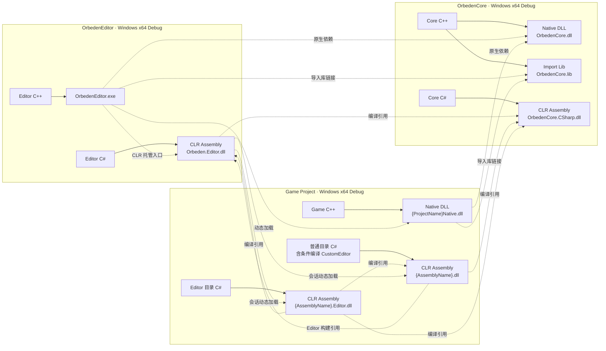
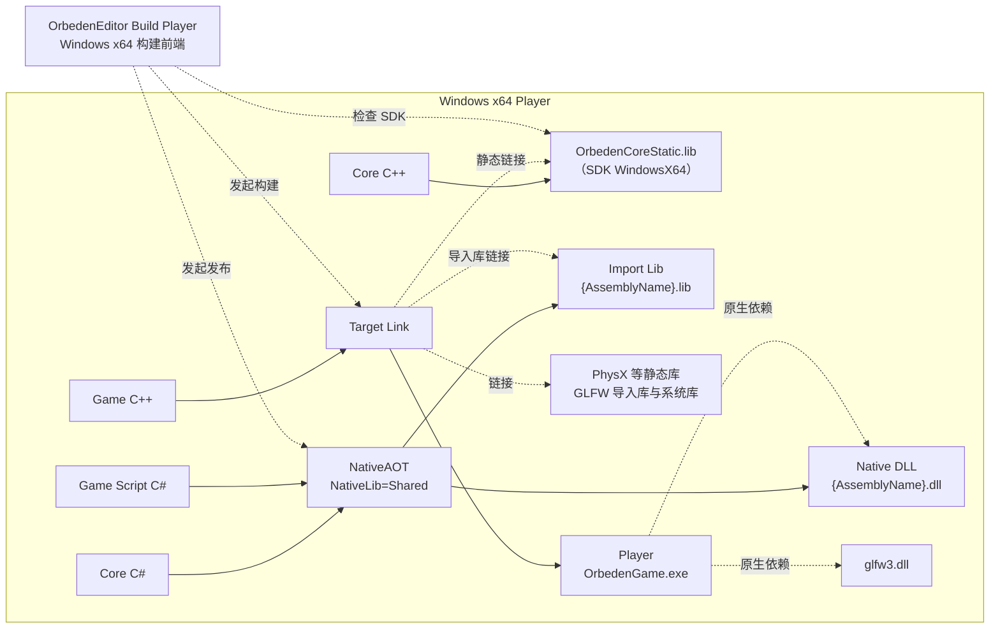
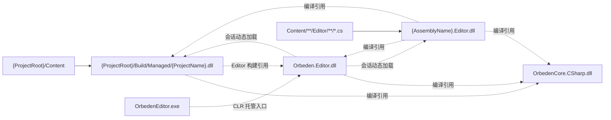

# Orbeden 构建与打包说明

本文说明 Orbeden 的 C++ / C# 构建关系，以及 Core、Editor、Game 在开发测试和发布打包时的职责边界。

## 总体原则

- **Editor/PIE 是 Windows x64 CLR 链路**：Core C#、Editor C# 和游戏脚本 C# 使用普通 CLR Assembly；Editor 自身可以构建 Debug 或 Release，当前游戏脚本构建入口固定使用 Debug。
- **Player 使用目标平台 NativeAOT**：进入最终 Player 的 Core C# 与游戏脚本 C# 一起编译。当前 Windows x64 使用原生 DLL 与导入库；其他平台的预留发布分支使用静态库。Player 的 Debug 与 Release 配置都走 NativeAOT。
- **Editor 代码由构建用途控制**：Editor/PIE 脚本构建传入 `OrbedenEditorBuild=true`，定义 `ORBEDEN_EDITOR` 并引用 `Orbeden.Editor.dll`；Player 打包传入 `OrbedenEditorBuild=false` 和 `PublishAot=true`，不包含这些代码和引用。
- **Editor 仅支持 Windows x64**：Debug 和 Release 配置都由 VS/MSBuild/MSVC 构建，不提供 Linux、FreeBSD 或 Switch Editor。
- **Core 和 Game 的 Release 产物需要跨平台**：不同目标分别选择 C++ 工具链、NativeAOT RID、PhysX/GLFW 等平台库，产物不能跨平台复用。
- **Editor 是构建工具而不是 Player 组成部分**：`Orbeden.Editor.dll` 是 Windows Editor 的 CLR 工具程序集，不进入任何配置的 Player；“Player 全部 C# AOT”指最终 Player 携带的全部 C# 代码。
- **Core C++** 不感知 C# 类型系统，不加载程序集，不依赖 hostfxr/nethost/runtimeconfig。
- **Physics** 固定使用 PhysX 5.9 CPU-only 静态库；不生成或链接 CUDA、PhysXGpu、NVTX、DLL/so。

## 模块性质与平台范围

| 模块 | 性质 | Debug | Release |
| --- | --- | --- | --- |
| `OrbedenCore` | 引擎运行时核心；包含文件系统、资源、渲染、物理、World 与 C# Native API | Windows x64；Editor/PIE 使用 `OrbedenCore.dll` 与导入库 `OrbedenCore.lib`，Core C# 使用 CLR DLL；Player 另用 `OrbedenCoreStatic.lib` | 同配置生成 Windows x64 Core DLL、导入库和静态库；Core C# 随游戏脚本进入目标平台 NativeAOT，其他平台需要对应 Core 静态库 |
| `OrbedenGame` | 独立 Player 外壳和游戏项目运行入口 | Windows x64 开发测试主要通过 Editor/PIE；独立 Debug Player 同样使用 NativeAOT | 按目标平台编译 Player C++，静态链接 Core 与第三方静态库；Windows 通过导入库调用游戏 NativeAOT DLL |
| `OrbedenEditor` | 项目制作、Inspector、PIE 与 Build Player 前端 | 仅 Windows x64；C++ Debug + Editor/Core/Game CLR Assembly | 仅 Windows x64；作为发布构建工具，不进入目标 Player |

跨平台表示 Core/Game 的 Release 架构和构建入口按目标平台区分，不表示仓库中的每个预留目标都已经可用。当前 Windows x64 是默认验证目标，Linux x64 需要对应环境和平台库；FreeBSD 与 Switch 仍受后文所列工具链、PhysX 和厂商 SDK 限制。

## 工程、产物与依赖

两张图均使用以下约定：

- 实线箭头 `-->` 表示“构建生成”。
- 虚线箭头 `-.->` 表示“依赖、引用、链接或运行时加载”，从使用方指向依赖方；边上的文字区分编译引用与动态加载。

### Editor/PIE：Windows x64 非 AOT 开发链路

本图描述 Windows x64 Editor、Inspector 和 Play-In-Editor。Core C#、Editor C#、游戏脚本 C# 都构建为 CLR Assembly；游戏 C++ 模块和 Editor 共享同一份原生 Core DLL。独立 Player 的 NativeAOT 构建见下一张图。



### Player：Windows x64 NativeAOT 链路

本图描述当前 Windows x64 Player，Debug 和 Release 都使用这条链路。Core C# 和游戏脚本 C# 作为同一发布闭包执行 `NativeLib=Shared` 的 NativeAOT，生成原生 `{AssemblyName}.dll` 与导入库 `{AssemblyName}.lib`；原生 DLL 随包发布。Editor 仅发起构建，不进入 Player 的编译引用或运行时依赖。



其他平台的预留分支使用 `NativeLib=Static`，将 `lib{AssemblyName}.a` 与目标平台 Core 静态库链接进 Player。当前 Windows Editor 的目标菜单只启用 Windows x64；不能把预留分支等同于已经验证的跨平台发布能力。

### 托管程序集的编译引用与加载关系

IDE 的设计时项目加载（`DesignTimeBuild=true`）在未显式设置 `OrbedenEditorBuild` 且不属于 NativeAOT 构建时，将该开关默认为 true，使普通脚本内的 Editor 条件代码获得智能提示。Editor API 引用由 SDK targets 提供，不要求游戏 `.csproj` 直接列出该 DLL；普通命令行构建和 Player 的编译边界保持不变。

以下表格省略 .NET 框架程序集。编译引用由 `.csproj` / `.targets` 配置，程序集元数据只保留实际用到的引用；没有 Editor 源文件时仍构建空的 `<Game>.Editor.dll`，它的元数据可能没有表中的业务引用。

| 程序集或编译输入 | 项目配置的引用 | 内容与用途 |
| --- | --- | --- |
| `OrbedenCore.CSharp.dll` | 无其他 Orbeden / Game 程序集 | Core 托管 API、生成绑定、脚本域和 UI；不引用 Editor 或游戏 |
| `Orbeden.Editor.dll` | `OrbedenCore.CSharp.dll` | Editor API、Inspector、构建前端；不静态引用具体游戏 |
| `<Game>.dll`，Editor/PIE 构建 | `OrbedenCore.CSharp.dll`、`Orbeden.Editor.dll` | 普通目录脚本与 `#if ORBEDEN_EDITOR` 内的同文件编辑器；游戏 C++ 方法经 Core 通用 Proxy 调用器访问 |
| `<Game>.Editor.dll` | `<Game>.dll`、`OrbedenCore.CSharp.dll`、`Orbeden.Editor.dll` | `Content/**/Editor/**/*.cs`，始终定义 `ORBEDEN_EDITOR` |
| `<Game>`，Player NativeAOT 编译输入 | `OrbedenCore.CSharp.dll` | 普通目录的 Runtime 代码；引用 Core 的内置类型绑定与通用 Proxy 调用器，不生成游戏 C++ 的 C# 绑定；不定义 `ORBEDEN_EDITOR`，不引用两个 Editor 程序集 |

`Orbeden.Editor.dll` 通过 `ManagedAssemblySession` 动态加载游戏及其 Editor 扩展，这与游戏的编译引用是两种关系，因此不构成编译循环。Core C# 与 Editor C# 在编辑器托管上下文中常驻；游戏及其 Editor 扩展加载到同一个可回收的 `SessionLoadContext`，并共享宿主已经加载的 Core / Editor 程序集。Inspector、场景回调与脚本域使用同一份游戏类型，重编译时一起卸载和重载。

Core C# 与游戏 C# 通过原生 API 函数表访问 Core 类型，通过 ComponentProxy 访问游戏 C++ 组件，不通过托管程序集引用原生 DLL。签名已知的方法在绑定时解析元数据，随后由 Core 的 NativeMethod / NativeAction 调用器通过具体类型函数指针传值；类型已知的字段通过 NativeField<T> 直接读写；动态方法与动态字段继续使用 InteropValue 协议。游戏原生模块只生成类型、字段、方法与生命周期元数据，不生成 C# 绑定。Editor 动态加载 `<ProjectName>Native.dll`；Player 直接编译同一批游戏 C++ 源码和反射生成代码到可执行文件，不分发这个 Editor 模块 DLL。

## 构建入口与输出

| 目标 | 构建方式 | 入口 | 输出 |
| --- | --- | --- | --- |
| Core C++/C# SDK for Editor | MSVC DLL + Import Library + CLR Assembly | Visual Studio `OrbedenCore.vcxproj` | Native SDK `OrbedenCore.dll` / `OrbedenCore.lib`，并自动生成和同步 `OrbedenCore.CSharp.dll` |
| Core C++ for Player | MSVC Static Library（`ArchiveCoreStaticLibrary`，归档同一批 obj） | 构建 `OrbedenCore.vcxproj` 时自动归档（x64） | `OrbedenEditor/Sdk/Native/WindowsX64/{Configuration}/OrbedenCoreStatic.lib` |
| PhysX CPU SDK | CMake/Ninja Static Libraries | `Build/BuildPhysX.ps1` / `Build/BuildPhysXLinux.sh` | `OrbedenCore/Src/ThirdParty/PhysX/lib/{Platform}/{Compiler?}/{Configuration}` |
| Core C# SDK | CLR SDK；Player NativeAOT 编译输入 | 构建 `OrbedenCore.vcxproj` 时自动执行 | Debug / Release 均为 `OrbedenCore.CSharp.dll`；Editor 运行时加载，Player 发布时作为 Game NativeAOT 的引用输入 |
| Editor C++ | MSVC Executable | VS 解决方案 / Editor 工程 | `OrbedenEditor/x64/{Configuration}/OrbedenEditor.exe`，链接 `OrbedenEditor/Sdk/Native/WindowsX64/{Configuration}/OrbedenCore.lib` |
| Editor C# | Windows Editor CLR 工具程序集 | Editor 工程构建时自动构建 | `OrbedenEditor/x64/{Configuration}/Managed/Orbeden.Editor.dll`；不进入 Player |
| Game C# for Editor/PIE | CLR Assembly Build，`OrbedenEditorBuild=true` | Editor `Ctrl+R` 或 `Build Game C#`，游戏脚本配置固定为 Debug | `{ProjectRoot}/Build/Managed/{AssemblyName}.dll` 与 `{AssemblyName}.Editor.dll` |
| Core + Game C# for Player | NativeAOT；Windows Shared，其余预留目标 Static | Editor `Build Player`，沿用 Editor 自身的 Debug / Release 配置 | `{ProjectRoot}/Build/Aot/{Target}/{Configuration}/`；Windows 为 `{AssemblyName}.dll` / `.lib` |
| Player | MSVC Executable（`OrbedenGame.vcxproj`）+ 资源打包 | Editor `Build Player`，沿用 Editor 自身配置 | `{ProjectRoot}/Build/windows-x64/bin/`，自包含发布目录：`OrbedenGame.exe`、`.oeproj`、`GameSettings.ini`、`Content/` |

### MSBuild 的定位

Editor 与 `Build/` 下的脚本都不写死 Visual Studio 的安装路径。Editor 的查找顺序为：`ORBEDEN_MSBUILD` 环境变量（显式指定，指向不存在的文件时直接报错，不静默改换工具链）→ `vswhere.exe` 查询（固定位于 `%ProgramFiles(x86)%\Microsoft Visual Studio\Installer\`，先只接受装了 x64 C++ 生成工具的实例，查不到再放宽条件）→ PATH 上的 `MSBuild.exe`（从 Developer Command Prompt 启动编辑器时命中）。三者都没有时 `Build Game C++` / `Build Player` 直接报错要求安装带 C++ 工作负载的 Visual Studio，不拼出一条注定失败的命令行。PowerShell 脚本点源 `Build/FindMSBuild.ps1`，走 vswhere → PATH 的顺序。

vswhere 给出实例后还要校验它自带的平台工具集：`Sdk/Native/Orbeden.Native.props` 里声明的 `PlatformToolset`（当前 v145）必须在该实例的 `MSBuild\Microsoft\VC\*\Platforms\x64\PlatformToolsets\` 下存在，缺了就报出实例路径，而不是等到 MSB8020。**工具集号与 VCTargets 目录号不是一回事**：VS 2026 的 v145 工具集位于 `MSBuild\Microsoft\VC\v180` 下，`v170` 下只有 v143。工具集随 VS 版本单调递增，因此最新实例没有目标工具集时，别的实例也不会有。

因此 Visual Studio 可以装在任意盘符，版本与版本号也不必是默认值。

## 完整打包流程

Windows x64 Editor/PIE 使用 CLR；Player 的 Core/Game C# 使用目标平台 NativeAOT。正式发布通常选择 Release，独立 Debug Player 也走 NativeAOT，不复用 Editor/PIE 的 CLR 游戏程序集。

0. **构建第三方库**：PhysX 未生成或有改动时运行 `.\Build\BuildPhysX.ps1 -Configuration Debug`（或 `Release`）；Linux 目标改用 `BuildPhysXLinux.sh`。`cgltf`、`stb`、`glad`、`imgui` 无需单独构建。

1. **构建 Core SDK**：在 Visual Studio 中构建 `OrbedenCore.vcxproj` 的 `x64|Debug` 或 `x64|Release`，生成 `OrbedenCore.dll`、导入库 `OrbedenCore.lib` 和 Player 静态库 `OrbedenCoreStatic.lib`，并自动生成、同步 `OrbedenCore.CSharp.dll`。

2. **构建 Editor**：构建同配置的 `OrbedenEditor.vcxproj`，生成 `OrbedenEditor.exe` 与 `Managed/Orbeden.Editor.dll`，同时复制 GLFW、nethost 和 runtimeconfig。Editor 仅支持 Windows x64。

   SDK 已构建后，可在 Editor 的 Dev 面板点击 `Update SDK`，手动刷新当前游戏工程 `Lib/OrbedenCore.CSharp.dll`、`Lib/Orbeden.Game.targets` 和 `Lib/OrbedenSdk.path`，同时将脚本工程导入迁移到新的共享游戏构建目标并删除旧转发文件；原生头文件、库与 MetaGen 工具继续通过 SDK 路径引用。该操作不依赖项目版本差异，保留 `Content/`，不执行编译或内容重置。结果显示在 Dev 面板和 Console，完成后通过 `Build Game C++`、`Build Game C#` 重建游戏模块。

3. **Debug 验证（可选）**：用 Debug Editor 打开 `.oeproj`；最新 Core C# DLL 会覆盖到 `{ProjectRoot}/Lib/`。按 `Ctrl+R` 或点击 `Build Game C#` 生成 `{ProjectRoot}/Build/Managed/{AssemblyName}.dll`，用于 Inspector 和 PIE。脚本构建在后台进程里跑，构建期间编辑器不冻结。

4. **Release Player**：用 Release Editor 选择 `Target Platform` 并点击 `Build Player`。Editor 先将 Core/Game C# 发布为目标平台 NativeAOT 库，再以 MSBuild 构建 `OrbedenGame.vcxproj`：该工程编译游戏 C++ 源码，链接 SDK 预编译的 `OrbedenCoreStatic.lib`、第三方静态库与 AOT 导入库，并把 AOT DLL、`glfw3.dll` 拷贝到输出目录 `{ProjectRoot}/Build/windows-x64/bin/`。**Player 不编译 Core 源码**：SDK 静态库缺失时构建直接失败并提示重新构建 `OrbedenCore.vcxproj`，不会回退到源码编译。

5. **打包资源**：Player 构建成功后，Editor 接着把内容根内的资源打成发布产物，`Build Player` 结束即得到完整发布目录。
   - 内容根内每个可导入的源文件经 `AssetPipeline` 导入，产生的**每个资源对象**序列化为一个 `.orbo`（`Orbeden::Object` 二进制），先写入 `{ProjectRoot}/ResourceCache/Player/`，再整体同步到 `{ProjectRoot}/Build/windows-x64/bin/Content/`。
   - `.world` 场景沿用 XML 格式：有绑定实例时经 World Cook 更新并移除编辑关联；无绑定实例时按字节原样复制。两者都保留相对内容根的目录结构。
   - `.oeproj` 复制到包根，供 Player 读取启动场景；项目根的游戏设置 `GameSettings.ini` 按项目当前状态镜像到包根——项目里有就覆盖，没有就删掉包里的旧副本（Player 随后用默认值）；没有导入器的文件（脚本、C++ 源码、`.mtl`、`.orbinc`）不进入发布包。
   - 打包会把内容根内全部资源导入当前进程，因此 `Build Player` 会保存并**重载一次当前场景**。`ResourceCache/Player/` 是本次 cook 重建的暂存区；`ResourceCache/Imported/` 保存编辑器导入产物与 `.import.status` 校验记录。整个 ResourceCache 可删除重建，不纳入版本管理；Content 中的 `.resinfo` 承载导入设置，必须保留并提交。

> Player 以**可执行文件所在目录**为根解析内容，发布目录整体拷到别的路径或别的机器都能运行。CLR DLL、hostfxr、nethost 和 Editor 文件不进入发布包。

## 核心工程文件职责

`OrbedenEditor.CSharp.csproj` 对应的实际工程文件为 `Orbeden.Editor.csproj`。

| 工程 | 主要操作 | 主要产物或后续动作 |
| --- | --- | --- |
| `OrbedenCore/OrbedenCore.vcxproj` | 以 MSVC/C++20 编译 Core；链接第三方库；x64 构建后自动执行同配置的 Core C# 工程并归档 Player 静态库 | `Sdk/Native/WindowsX64/{Configuration}/OrbedenCore.dll`、`OrbedenCore.lib`、`OrbedenCoreStatic.lib` |
| `OrbedenCore/Managed/OrbedenCore.CSharp/OrbedenCore.CSharp.csproj` | 构建 `net10.0` CLR SDK并允许 unsafe；构建后把 DLL、PDB、`.deps.json`（存在时）同步到 Game SDK | Editor 与 Game 的 `Sdk/Managed/OrbedenCore.CSharp/` |
| `OrbedenEditor/OrbedenEditor.vcxproj` | 编译并链接 Editor C++、Core、PhysX、GLFW、nethost 和系统库；构建后复制运行库并自动执行同配置的 Editor C# 工程 | `x64/{Configuration}/OrbedenEditor.exe`、运行库与 `Managed/` |
| `OrbedenEditor/Managed/Orbeden.Editor/Orbeden.Editor.csproj` | 构建 `net10.0` Editor CLR 程序集；引用并复制 Core C# SDK；不执行 NativeAOT | `x64/{Configuration}/Managed/Orbeden.Editor.dll`（由 Editor C++ 工程指定输出目录） |

## 第三方库构建脚本

以下命令均从仓库根目录执行。PowerShell 脚本只负责预构建第三方库；Core C++ 与 Core C# SDK 统一通过 Visual Studio 构建 `OrbedenCore.vcxproj`。脚本内部根据 `$PSScriptRoot` 推导仓库和输出目录，不依赖仓库所在盘符。

构建并打包 Windows CPU-only PhysX。默认源码目录是仓库同级的 `PhysX-110.1-omni-and-physx-5.9.0`，也可传入相对仓库根目录的其他位置：

```powershell
.\Build\BuildPhysX.ps1 -Configuration Debug
.\Build\BuildPhysX.ps1 -Configuration Release
.\Build\BuildPhysX.ps1 -Configuration Release -PhysXSource "..\PhysX-110.1-omni-and-physx-5.9.0"
```

Game C# NativeAOT 发布不是 PowerShell 脚本入口。Editor 的 `Build Player` 会调用 `Orbeden.Editor` 内建的 C# `PlayerBuildPipeline`，发布后的 Editor 不需要携带额外 `.ps1`。

## Editor 版 Core DLL 与导入库

Editor 不直接引用 `OrbedenCore.vcxproj`，通过已经构建好的 WindowsX64 导入库 `OrbedenCore.lib` 链接 Core DLL，并将 `OrbedenCore.dll` 复制到编辑器输出目录。游戏原生模块也引用同一导入库，运行时共享编辑器进程中的 Core DLL。修改 Editor C++ 时，构建 `OrbedenEditor` 不会重新编译 Core。

修改 Core C++ 或 Core C# 后，在 Visual Studio 中构建对应配置的 `OrbedenCore.vcxproj`。该工程同时刷新 Core DLL、导入库、Player 静态库和 Core C# SDK。

## Player 版 Core 静态库与分层

`OrbedenCore.vcxproj` 构建后自动把本次编译产出的 obj 归档为 `OrbedenCoreStatic.lib`（同一批对象，不重复编译）。DLL 与静态库共享一次编译的前提是 Core 不引用用户层符号：

- Core 是底层 SDK，**不引用 `OrbedenGame`（Player）的任何符号**，也不引用游戏程序集的 AOT 导出。
- 脚本入口由宿主在运行前注入：Editor 走 `SetClrEntryPoints`，Player 在 `game_main.cpp` 里声明 AOT 导出并调用 `SetAotEntryPoints`。
- 因此 `ORBEDEN_PLAYER` 编译分支已移除，两个消费者使用完全相同的 Core 对象；静态库缺失时 Player 构建直接报错。

Editor DLL 与导入库、Player 静态库的输出目录固定为：

```text
OrbedenEditor/Sdk/Native/WindowsX64/{Configuration}/
├─ OrbedenCore.dll
├─ OrbedenCore.lib        # Editor / 游戏模块使用的导入库
└─ OrbedenCoreStatic.lib  # Player 使用的静态库
```

`OrbedenEditor.vcxproj` 只消费 Windows x64 版本；Editor 的 Debug 和 Release 都不提供其他宿主平台或架构。

## PhysX 5.9 CPU-only 静态包

PhysX 源码位置默认为仓库同级目录：

```text
../PhysX-110.1-omni-and-physx-5.9.0
```

引擎只使用其中的官方 `physx` SDK。`blast`、`flow`、`omni`、`ovphysx` 不进入 Orbeden。构建固定开启/关闭以下选项：

```text
PX_GENERATE_STATIC_LIBRARIES=ON
PX_GENERATE_GPU_PROJECTS=OFF
PX_GENERATE_GPU_STATIC_LIBRARIES=OFF
PX_USE_NVTX=OFF
PX_BUILDSNIPPETS=OFF
PX_BUILDPVDRUNTIME=OFF
```

这不是 PhysX 4，而是 PhysX 5.9 的 CPU 功能子集。CPU 刚体、场景查询、Cooking、CCT、joints、articulations 和 vehicle 仍来自 5.9；被禁用的是 GPU rigid pipeline、CUDA broadphase、PBD 粒子以及 GPU deformable surface/volume 等必须依赖 NVIDIA CUDA 的路径。官方公共头文件仍保留部分 GPU ABI 声明，但引擎统一定义 `DISABLE_CUDA_PHYSX`，因此 `PX_SUPPORT_GPU_PHYSX=0`，不会编译或调用这些功能。

完整 CPU 包包含 8 个静态模块：

```text
PhysX
PhysXCommon
PhysXFoundation
PhysXExtensions
PhysXPvdSDK
PhysXCooking
PhysXCharacterKinematic
PhysXVehicle
```

头文件、版本和 BSD-3-Clause 许可证位于：

```text
OrbedenCore/Src/ThirdParty/PhysX/
```

### Windows x64

Debug 和 Release 使用上节的 `BuildPhysX.ps1` 构建。

输出会自动安装并复制到：

```text
OrbedenCore/Src/ThirdParty/PhysX/lib/WindowsX64/{Configuration}/
```

Windows 库采用 MSVC ABI，可同时由 MSVC 和 clang-cl 消费，不重复保存两份相同 ABI 的大体积归档。Windows CRT 与引擎一致使用 `/MD` 或 `/MDd`。

### Linux x64

Linux 静态库必须在 x86_64 Linux 环境中构建。推荐使用一台原生 Linux 电脑；WSL 也可以使用同一脚本，但不是必需条件。

Ubuntu / Debian 安装 PhysX 构建工具：

```bash
sudo apt update
sudo apt install -y build-essential clang cmake ninja-build
```

Fedora 安装对应工具：

```bash
sudo dnf install -y gcc gcc-c++ clang cmake ninja-build
```

如果随后还要在该电脑上链接完整 Orbeden Player，Ubuntu / Debian 另外安装 `libglfw3-dev libgl1-mesa-dev`，Fedora 安装 `glfw-devel mesa-libGL-devel`。

默认目录布局如下。PhysX 源码目录与 Orbeden 仓库同级，因此仓库移动到其他位置后不需要修改脚本：

```text
workspace/
├── orbeden/
└── PhysX-110.1-omni-and-physx-5.9.0/
    └── physx/
        └── CMakeLists.txt
```

进入仓库根目录，分别构建 Clang/GCC 的 Debug/Release 四套静态库：

```bash
cd orbeden
bash ./Build/BuildPhysXLinux.sh Debug Clang
bash ./Build/BuildPhysXLinux.sh Release Clang
bash ./Build/BuildPhysXLinux.sh Debug GCC
bash ./Build/BuildPhysXLinux.sh Release GCC
```

如果 PhysX 不在默认同级目录，第三个参数可传入相对仓库根目录的源码位置。参数既可以指向包含 `physx/` 的源码包根目录，也可以直接指向 `physx/`：

```bash
bash ./Build/BuildPhysXLinux.sh Release Clang ../vendor/PhysX-110.1-omni-and-physx-5.9.0
bash ./Build/BuildPhysXLinux.sh Release GCC ../vendor/PhysX-110.1-omni-and-physx-5.9.0/physx
```

脚本会把源码复制到 `Build/.cache/PhysX-5.9.0/physx-linux` 后配置，避免 CMake 生成文件污染下载的 PhysX 源码。安装结果先进入 `Build/.cache/PhysX-5.9.0/stage`，随后自动复制头文件和静态库到引擎第三方目录：

```text
OrbedenCore/Src/ThirdParty/PhysX/include/
OrbedenCore/Src/ThirdParty/PhysX/lib/LinuxX64/{Clang|GCC}/{Configuration}/
```

每个配置应包含 8 个 `.a`。脚本会自动拒绝 `PhysXGpu`、CUDA 和 `.so` 产物；构建后可再手动检查数量与目标格式：

```bash
find OrbedenCore/Src/ThirdParty/PhysX/lib/LinuxX64 -type f -name '*.a' -print | sort
file OrbedenCore/Src/ThirdParty/PhysX/lib/LinuxX64/Clang/Release/libPhysX_static_64.a
file OrbedenCore/Src/ThirdParty/PhysX/lib/LinuxX64/GCC/Release/libPhysX_static_64.a
```

四套全部生成时共有 32 个归档文件。`file` 应报告当前 x86-64 Linux 工具链生成的 archive，目录中不应出现 `.lib`、`.dll`、`.so` 或 `PhysXGpu`。Windows 只有在配置完整 Linux sysroot 和交叉工具链时才能交叉编译，Windows `.lib` 不能当作 Linux `.a` 使用。

FreeBSD 和 Switch 当前明确不支持 PhysX：仓库没有经过验证的上游平台端口，也没有 Switch 厂商 SDK。对应目标在打包下拉框中置灰，不会进入发布流程，也不会回退到无物理或其他实现。

### 原生物理接口

`Application::GetSystem<PhysicsSystem>()` 返回内建 `PhysicsSystem`。C++ 端现有高层能力包括：

- `RigidBody`：Static、Dynamic、Kinematic、质量、阻尼、重力、CCD 和轴锁定。
- `Collider`：Box、Sphere、Capsule、ConvexMesh、TriangleMesh、Trigger、材质和 layer/mask。
- `CharacterController`：Capsule/Box CCT、step/contact/slope 和 layer/mask。
- `Raycast`、`SweepSphere`、`OverlapSphere`、接触/Trigger 事件与 CCT 移动/传送。

Dynamic 刚体和 CCT 必须是根实体。TriangleMesh 不允许用于 Dynamic 刚体，应改用 ConvexMesh。静态和 Kinematic Actor 会读取层级后的世界变换；Dynamic Actor 将模拟结果写回根实体局部变换。

高级 C++ 模块可通过 `GetPhysics()`、`GetScene()`、`GetCookingParams()`、`GetRigidActor()` 等原生句柄自行创建 joints、articulations 和 vehicle。PhysX 5.9 Cooking 已改为无状态函数，因此暴露的是 `PxCookingParams`，不是旧版 `PxCooking*` 对象。

### C# 物理组件绑定

Core C# SDK 提供 `RigidBody`、`Collider` 和 `CharacterController` 包装，可通过 `Ens` 添加、判断和获取：

```csharp
Ens bodyEns = Ens.Create("Body");
Collider collider = bodyEns.AddCollider()!;
collider.shape = ColliderShape.Box;
collider.halfExtents = new vector3(0.5f, 0.5f, 0.5f);

RigidBody body = bodyEns.AddRigidBody()!;
body.bodyType = PhysicsBodyType.Dynamic;
body.mass = 2.0f;
body.lockFlags = PhysicsLockFlags.RotationX | PhysicsLockFlags.RotationZ;

RigidBody? sameBody = bodyEns.GetComponent<RigidBody>();
```

组件绑定覆盖所有可序列化配置字段和刚体速度。物理查询、事件、CCT `Move`/`Teleport` 属于后续 `PhysicsSystem` 托管绑定，不包含在本组件绑定中。

## Editor 的 Player 目标平台

`Build Game` 面板的 `Build Player` 按钮前有 `Target Platform` 下拉框。该选项只影响 Player，不影响 Windows x64 Debug Editor/PIE。

| Target Platform | Game C# AOT 目标 | 状态 |
| --- | --- | --- |
| Windows x64 | `windows-x64` / `{AssemblyName}.lib`（NativeLib=Shared，DLL 随 Player 分发） | 默认验证目标 |
| Linux x64 / Linux x64 GCC / FreeBSD x64 / Switch | — | 下拉框置灰；需要目标机或厂商工具链，不在 Windows Editor 中发起 |

`Build Player` 的流程固定为：

1. C++ Editor 将项目、配置和目标传给 `Orbeden.Editor`，由 C# `PlayerBuildPipeline` 直接执行 `dotnet restore/publish` 并校验 Game NativeAOT 库。
2. 以 MSBuild 构建 `OrbedenGame/OrbedenGame.vcxproj`：编译游戏 C++ 源码，链接 SDK 预编译的 `OrbedenCoreStatic.lib`、第三方库与 AOT 导入库，最后拷贝 AOT DLL 与 `glfw3.dll` 到输出目录。Core 静态库缺失时构建失败并提示先构建 `OrbedenCore.vcxproj`。
3. C++ Editor 调 `PlayerContentCooker` 把内容根内的资源导入并序列化为 `.orbo` 写入 `ResourceCache/Player/`，再同步到包内 `Content/`、复制 `.oeproj` 到包根；随后保存并重载一次当前场景。

NativeAOT 命令参数、RID 和输出目录集中在 `OrbedenEditor/Managed/Orbeden.Editor/PlayerBuildPipeline.cs`，可直接随 Editor C# 代码定制。失败时不会回退到 PowerShell、DLL 或 CLR 工作流。

## Debug Editor 测试流程

Debug Editor 仅支持 Windows x64，测试流程不使用 NativeAOT 静态库。Core C#、Editor C# 和游戏脚本 C# 全部使用 CLR Assembly。



- 非 Play 状态下，Inspector 使用游戏程序集反射脚本类型，通过原生 `Script` 宿主显示和编辑字段；编辑态脚本域同时维护脚本实例与帧系统，但跳过游戏生命周期。自定义 Inspector 可以显式调用对应脚本实例的方法。
- 编辑态与 Play 的 CLR 脚本入口均由 `Orbeden.Editor.EditorRuntime` 转发给共享的 Core C# 脚本域。进入 Play 前关闭编辑态世界实例，再以 Play 模式重建；游戏程序集会话仍由 `ManagedAssemblySession` 统一持有。
- Inspector 同时显示原生 C++ 组件块和用户 C# 组件块。
- 同文件的 CustomEditor 从游戏主程序集发现，`Editor` 目录的 CustomEditor 从 `<Game>.Editor.dll` 发现，两者使用同一份脚本类型。

## Release Player 内容

发布版 Player 携带：

- `OrbedenGame`
- `Content/` 下的资源产物 `.orbo`（`Orbeden::Object` 二进制）与清单 `cooked.index`
- `Content/` 下经 World Cook 处理的 `.world` 场景（无绑定实例时原样复制）
- 包根的 `.oeproj` 项目配置
- 包根的 `GameSettings.ini` 游戏设置（镜像项目根，项目里没有就不保留）
- 平台需要的原生依赖

发布目录里**没有**原始资源文件（`.obj` / `.png` / `.mtl` / `.orbshader`）与脚本源码——它们已经在打包时转换进 `.orbo` 或编译进 Player。

Core C# 和游戏脚本 C# 已一起编译成 NativeAOT 原生产物，不再以 CLR DLL 形式部署。当前 Windows x64 Player 通过 `{AssemblyName}.lib` 导入库调用同名 NativeAOT 原生 DLL，该 DLL 必须随包部署；其他平台的预留分支将 NativeAOT 静态库链接进 Player。不同平台的 NativeAOT 产物、Core C++ 静态库和第三方平台库不能混用。

发布版 Player 不携带：

- 游戏的 CLR `{AssemblyName}.dll`（Windows 包中的同名 DLL 是 NativeAOT 原生 DLL）
- `{AssemblyName}.Editor.dll`
- `OrbedenCore.CSharp.dll`
- `Orbeden.Editor.dll`
- `hostfxr`
- `nethost`
- `runtimeconfig.json`

## 资源产物与解析规则

### `.orbo` 格式

一个资源对象一个 `.orbo` 文件，**位置式二进制**：只写字段顺序与长度，不写字段名。

- 变长字段靠长度前缀自洽：`string` = `uint32 字节数 + 字节`，数组 = `uint32 个数 + 元素整块`。
- 顶点、索引、像素等长数组按原始字节块读写，依赖 `Runtime/EngineTypes.h` 对数学类型 `trivially_copyable` 的静态断言。
- 头部带资源 Key、运行时类型名、依赖 Key 列表，以及源文件时间戳/大小与一个预留的导入器版本槽位（恒写 0，只写不读，留给将来的失效机制）。
- 读完后游标必须正好落在文件末尾，否则判定为格式错配。

**位置式格式的代价**：引擎改动一旦触及资源字段（增删字段、调整顺序、改类型），**已发布的旧包不再可读，必须重新 `Build Player`**。这与「world 文件不带版本号、格式变更靠改文件而非读时兼容」是同一套约定。

### 文件名与清单

扁平存放，文件名是资源 Key 的十六进制哈希（`StringId::CalculateHash`）。`Key → 文件名` 是纯函数，不需要索引就能查找。

`cooked.index` 是 cook 生成的对照表，每行 `<hash16>\t<资源Key>`。它有两个用途：内置 Shader（`shadow_depth.orbshader` / `skybox.orbshader`）本来就靠**文件名**在内容根内查找，哈希命名抹掉了文件名，打包后只能靠清单匹配；同时它也让人能看出哈希文件对应哪个资源。

### 解析顺序与回退

`ResourceManager` 按 Key 取资源时是**对称的双向回退**，没有 Editor/Player 分支：先找 `Content/<hash16>.orbo`，找不到再按 Key 读源文件并导入。

由此得出两条必须遵守的约定：

1. **工程 `Content/` 内绝不能出现 `.orbo`。** 产物与源文件同目录时产物优先，且**不会有任何提示**——Editor 会静默改用产物，改源文件不再生效。cook 只写 `ResourceCache/` 与发布目录，天然满足，但这是约定而不是代码约束。
2. **发布目录里只放产物，不放源文件。** 否则产物缺失时会静默回退到源文件导入，问题被掩盖。

`Content/` 之外（即 Editor）永远是源优先：那里没有 `.orbo`，读不到产物自然走导入。**当前不做任何过期校验**——改了源文件不会自动重建产物，`Build Player` 一律全量重 cook。

## 游戏工程布局

游戏工程只分两部分：**内容根 `Content/`** 是给用户用的，内部结构完全自由；内容根之外的一切都由引擎与构建系统强依赖，位置固定且可整块重建。

构建脚手架一律**引用 SDK**，项目内不保留引擎设置的副本：工具集、include、链接库、MetaGen 参数与源文件收集都由 SDK 的共享属性表提供。引擎改动只需刷新 SDK。

### 模板分区

`OrbedenEditor/Templates/` 下分四部分：

| 目录 | 内容 | 去向 |
| --- | --- | --- |
| `Project/` | 工程脚手架：`.oeproj`、`*.csproj`、`*.vcxproj`、`Directory.Build.props` | 铺到项目根 |
| `Builtin/` | 默认着色器、材质与基础网格，含引擎按文件名查找的 `shadow_depth.orbshader` 与 `skybox.orbshader` | 新建时铺到 `<项目根>/Content/Builtin/`；之后由 Dev 面板单独重置 |
| `Examples/` | 示例内容：场景、资源、脚本与原生组件 | 新建时铺到 `<项目根>/Content/Examples/`；之后由 Dev 面板显式重置 |
| `Shared/` | 共享属性表与固定桥接源码：`Orbeden.Native.props` / `.targets`、`GameModule.cpp`、`GameAotExports.cs` | 由 `PublishNativeGameSdk` 发布到 `Sdk/Native/` 与 `Sdk/Shared/`，不铺进项目 |

`Project/` 中不得包含任何游戏内容：示例内容一旦与项目自身内容同名，会同时撞上 C# 的全限定类型名、MetaGen 的类型字典和 Player 的链接符号。

### 项目目录

```text
MyGame/
├─ MyGame.oeproj            项目配置：startupWorld / lastWorld
├─ MyGame.csproj            工程文件直接放在项目根
├─ MyGameNative.vcxproj
├─ Directory.Build.props
├─ GameSettings.ini         游戏设置：分块存放（[Rendering] 曝光、[Layers] 层名与碰撞矩阵），与内容根无关
├─ Lib/                     SDK 快照：Core C# 运行库、绑定目标转发、OrbedenSdk.path、用户手册 Lib/Docs/
├─ ResourceCache/           资源导入产物缓存，可由 cook 全量重建（可删除，不进版本控制）
├─ Content/                 内容根：内部结构完全自由
│   ├─ Meshes/  Materials/  Textures/  Shaders/  Scenes/  Scripts/
│   └─ Examples/FlightTraining/   可编辑的示例游戏
└─ Build/                   全部构建产物
    ├─ Managed/             C# 开发程序集、obj、PIE 影子副本
    ├─ Aot/                 NativeAOT 库
    ├─ Native/              模块 DLL、obj 与 MetaGen 的 Generated/
    └─ windows-x64/
        ├─ obj/             编译中间文件
        └─ bin/             自包含发布目录
            ├─ OrbedenGame.exe / glfw3.dll / {AssemblyName}.dll
            ├─ {ProjectName}.oeproj
            ├─ GameSettings.ini    游戏设置（镜像项目根，项目里存在时才有）
            └─ Content/     .orbo 产物（扁平，文件名是资源 Key 的哈希）
                            cooked.index（文件名与资源 Key 对照表）
                            **/*.world（保持原目录结构）
```

`Content/` 下的六个初始子目录只是**新建时的默认结构**，之后可以随意增删改名。`.oeproj` 只记 `startupWorld` 与 `lastWorld`——位置既然固定，就不该做成可配置属性。

`Lib/Docs/` 里的用户手册是引擎仓库 `Docs/Manual/` 的副本：引擎构建生成并发布到 `Sdk/Manual/`，游戏工程构建时整块刷新，与 `Lib/` 下其他 SDK 快照同一生命周期。工程内不手工维护这份文档，自己的笔记写进 `Content/`。

两个场景 Key 各服务一端，不要混：

| 属性 | 服务对象 | 说明 |
| --- | --- | --- |
| `startupWorld` | 打包后的 Player | 启动时装载哪个场景。编辑器只在 `lastWorld` 缺失或失效时回退到它 |
| `lastWorld` | 编辑器 | 开发者最后编辑的场景，切换场景时写入；重新打开项目回到它 |

两者都相对内容根。`lastWorld` 引用的场景被删或被改名时（改名会随引用重写一起更新），打开项目退回 `startupWorld`。PIE 用的是**当前打开的场景**，与这两个属性都无关。

`ResourceCache/` 与 `Content/` 同级。`Imported/` 按 Content 目录结构保存带源文件名前缀的 `.orbo` 产物及模型的 `<源文件名>.prefab` 子树文档，Project/Inspector 读取伴生文件的清单，ObjectField 可按对象加载缓存；`Player/` 独立保存 cook 暂存产物并同步进发布目录，打包不会清空 Imported。产物**不纳入版本管理**，Reimport 原位置重建，不保留历史代次，进程交换结果不落盘。详见 [资源 Inspector 设计](AssetInspectorDesign.md)。

**每个源文件有一个伴生 `.resinfo`**：与源文件同址同名、只多一个后缀，分两部分——

| 部分 | 归属 | 生命周期 |
| --- | --- | --- |
| 导入设置 | 用户数据，Inspector 可编辑 | **重新导入时保留**，随资源进版本管理 |
| 内部隐含资源清单 | 重新生成 | 每次导入重建（对象 Key、类型、依赖、反射摘要） |

伴生文件必须进版本管理：它是导入设置的唯一载体，丢了设置就没了。对象 `.orbo`、模型生成的 `.prefab` 及整个 `ResourceCache/` 都可以全量重建，因此不进版本管理。`*.resinfo.tmp` 是原子写入的中间文件，仍被忽略。

`Dependencies` 只保存引用路径；同路径资源内容改变不修改该列表。`ImportStatus` 保存源文件自身的内容状态，完整依赖内容校验记录另存 `ResourceCache/Imported/*.import.status`。文本长度排除回车与换行，内容指纹把 CRLF 按 LF 计算；内容未变时保留 `Modified`，生成 JSON 相同时不写回。项目模板的 `.gitattributes` 使用 `text=auto eol=lf`，覆盖 `core.autocrlf` 的 LF 到 CRLF 检出转换；入库仍统一为 LF，二进制不转换。

### 内容根与资源 Key

**所有 `Object` 派生资源的 stringid 都是内容根相对路径**：`Meshes/cube.obj` 对应 `<项目根>/Content/Meshes/cube.obj`。`startupWorld` 同样相对内容根。Key 里没有 `Resource/` 这类前缀特判，解析就是一次路径拼接。

### 原始内容 RawContent

`Content/RawContent/` 是可选的原始内容目录，名称固定，只有内容根下这一层具有特殊含义。打包时将目录及全部文件按原有结构和字节复制到发布包的 `Content/RawContent/`，包含空文件、空目录、隐藏文件及任意扩展名；不生成资源对象，不执行 Cook，也不收集为 C#／C++ 脚本或绑定输入。目录不存在时无需创建。每次打包重建 Player 暂存目录并镜像到发布包，因此删除的原始文件不会残留在下次发布中。

编辑器与 Player 使用相同的相对路径，从当前内容根的 RawContent 读取文件：

```csharp
if (Orbeden.FileSystem.ReadRawContent("Data/settings.json", out byte[] content))
{
    //使用原始字节
}
```

```cpp
List<uint8> content;
if (FileSystem::ReadRawContent("Data/settings.json", content))
{
    //使用原始字节
}
```

参数相对 `RawContent/`，不包含该目录前缀；支持子目录，拒绝绝对路径及越出目录的 `..` 路径。空文件返回成功和空数据；不存在、不可读、路径无效或超过 2 GiB 限制的文件返回失败并清空输出。内容不做文本解码、换行转换或资源反序列化。

### 位置无关

除 `RawContent/` 外，脚本、资源、场景放在内容根内任何目录都能生效，新增文件不需要改工程：

- **C#**：`Directory.Build.props` 关掉 SDK 默认编译项通配，由 SDK 的 `Orbeden.Game.targets` 收集 `Content/**/*.cs`，不生成或编译游戏 C++ 绑定。
- **C++**：`Orbeden.Native.targets` 收集 `Content/**/*.cpp`；Player 的 `OrbedenGame.vcxproj` 同样。
- **场景**：`startupWorld` 与 `EditorProject::OpenWorld` 都以内容根为基准，在 Project 面板双击 `.world` 即可切换。
- **内置 Shader**：`shadow_depth.orbshader` 与 `skybox.orbshader` 由引擎**按文件名在内容根内查找**（结果缓存），不要求固定位置；新建项目铺到 `Content/Builtin/Shaders/`，之后由 Dev 面板的 `Reset Builtin` 管理。同名多份时引擎取字典序靠前的一份并打一条告警，所以同一内容根内只应保留一份。

内容根之外按定义不含用户内容；glob 只排除原始内容目录及独立编译的 Editor 脚本。这些通配符会让 Visual Studio 对工程给出通配符警告，只影响 IDE 设计时行为，不影响构建——编辑器构建游戏模块走命令行 MSBuild。

### 引擎更新与项目同步

#### 版本 106：类型化原生方法与字段绑定

完整运行时 OrbedenNativeApi 升至 ABI 7、117 个指针槽，尾部追加指向独立 3 槽 TypedFieldsApi 的指针。TypedMethodsApi 保持 3 槽、动态 ScriptInteropApi 保持 9 槽，Editor 引擎子表维持 ABI 5、74 槽。FieldInfo 新增具体类型与读写函数入口，原生游戏模块 ABI 升至 6；不能混用旧游戏 DLL、旧 MetaGen 生成物或旧 Core 程序集。

新增 ComponentProxy.TryBindField 与 NativeField<T>.Get / Set，初始化时按名称和类型绑定，后续不再查名称或经过通用值容器。生成访问器保留显式 getter/setter、只读/只写、Changed 与 World 脏标记，bool setter 拒绝时不继续通知；继承的 Script.enabled 使用业务入口。字段和方法共用主线程、代次、重入与模块卸载保护。数组、对象引用和未定义 ABI 的自定义类型继续使用动态协议。

按下列升级步骤重新构建 Core、Editor、游戏并同步 SDK。已有需要频繁调用 SetField / TryGetField 的 C# 脚本可迁移为缓存 NativeField<T>，无需手写字段偏移或游戏 C# Binding；没有场景或资源格式迁移。当前游戏的 255 项互操作检查已在 CLR Debug/Release 和 NativeAOT Release 通过；字段写入的同轮 Release 耗时减少约 58%，为零托管分配。验证范围和具体数据见[脚本系统](ScriptSystem.md#87-性能验证范围)。

#### 2026-10-22：方法类型化更新记录（字段绑定之前）

当前完整运行时表 `OrbedenNativeApi` 为 ABI 6、116 个指针槽，尾槽指向独立的 3 槽 `TypedMethodsApi`；动态 `ScriptInteropApi` 仍为 9 槽，Editor 引擎子表仍为 ABI 5、74 槽。原生游戏 DLL 描述 ABI 为 5，`MethodInfo` 增加具体类型调用入口。不能将旧生成代码或旧游戏 DLL 与新 Core 混用。项目存档版本与这些二进制 ABI 版本分别管理。

Core MetaGen 在 `--bindings` 模式生成 `NativeMethods.Generated.cs`，包含 0～16 参数的通用 NativeMethod / NativeAction；游戏 `--game-module` 模式只生成游戏原生元数据与调用 thunk，不产生游戏专用 C# Binding。C# 数值调用直接传值，字符串使用 UTF-8 视图；CLR 与 NativeAOT 共用相同签名。接口及迁移示例见[脚本系统](ScriptSystem.md#8-跨语言代理)。

升级现有工程时：

1. 停止 Play，构建所用配置的 Core，刷新 MetaGen、原生 SDK 与 Core 托管程序集；若同时使用 Debug / Release，应分别构建对应原生库。
2. 构建并重启 Editor，再通过 Update Project 同步游戏的 SDK 引用、工具、头文件与 `Lib` 程序集。Core 托管 SDK 路径由最后一次构建覆盖，测量 Release 时须确认其配置。
3. 重新运行游戏 MetaGen，构建游戏 C++ DLL、C# 脚本及编辑器扩展。高频原生调用改为缓存 NativeMethod / NativeAction；FlightHud 与 SampleBehaviour 模板已更新，已有项目按需同步相应脚本。
4. 发布项目时重新 Build Player，使 Core、游戏 C++ 与 NativeAOT 产物使用同一套新 ABI。更新不涉及场景或资源格式迁移。

本次已通过 Windows x64 Core Debug/Release、Editor Debug、游戏原生 Debug/Release 和游戏托管 Release 构建；AviatorSage 的 173 项互操作检查在 CLR Debug/Release 及 NativeAOT Release 下通过。13 个 getter 的同轮类型化调用耗时分别减少约 26% / 25%，为零托管分配；这是互操作测试结果，未完成完整 Player 发布或 Editor Play 人工验收。性能方法和完整数值见[脚本系统](ScriptSystem.md#87-性能验证范围)。

#### 项目存档版本历史

版本 105：Core 托管包装改为强 GC 句柄保活，原生对象销毁、程序集卸载和引擎 API 断开时释放；显式未使用对象回收期间临时弱化可回收对象的包装，并恢复仍存活包装的强句柄。引擎原生 API 主版本升至 5，原生游戏模块 ABI 升至 3，Core、Editor、游戏模块和 Player 必须一起重建。整个游戏原生模块停止生成 C# 包装及 Binding 注册，但 MetaGen 继续生成类型、字段、方法、序列化和生命周期元数据，Inspector 与跨语言 Proxy 继续使用它们。游戏泛型组件查询跳过无绑定类型，引用编辑直接使用原生对象 ID 和稳定 Key。共享游戏构建目标改名为 `Orbeden.Game.targets`，更新 SDK 时迁移脚本工程导入并删除旧转发文件；原生构建删除旧游戏绑定生成物，Player 只编译游戏反射生成文件。FlightTraining 的 FlightHud 改为缓存 Proxy 方法句柄，Propeller 删除未使用的旧原生绑定字段。需先构建 Core 和 Editor，更新项目 SDK，再重建游戏 C++／C# 与 Player；已有游戏 C# 对生成原生类型的调用需改为 Proxy，示例需同步 FlightHud 源码。无场景、资源格式迁移。已通过 Windows x64 Debug 的 Core、原生与托管 Editor、FlightTraining 原生与托管模块及编辑器扩展构建；Player 仅完成编译阶段，未执行完整链接。未运行功能、回归或编辑器冒烟测试。

版本 104：修复游戏 C# 构建从项目文件候选集中优先选中旧版同名 SDK DLL 的问题。共享绑定目标从普通与设计时程序集搜索路径中移除 `{CandidateAssemblyFiles}`，保留显式 HintPath、框架和其他已配置路径；新建与修复工程的基础属性排除整个 `Build/` 默认文件扫描。当前 SDK 的共享目标已同步，AviatorSage 下次构建直接使用修正后的引用配置，无需删除历史构建目录或改动脚本。正常发布流程需构建 Core 刷新 SDK，构建 Editor 更新工程修复逻辑，再同步项目；没有 ABI、资源格式或场景迁移。已检查 DLL 元数据，并通过 AviatorSage 的 MSBuild 配置求值与程序集引用解析确认 Core 和 Editor 均由 HintPath 选中新 DLL；未编译 Core／Editor／游戏，未运行测试。

版本 103：Dev 面板新增 `Update SDK`，复用现有 SDK 同步入口更新当前项目的 Core C# 运行库、绑定构建转发文件与 SDK 路径；操作结果写入项目状态、Dev 报告与 Console，Play 或后台脚本构建期间拒绝执行。通过已有编辑器请求入口追加操作种类，原生函数表布局不变。按钮使用已经发布的 SDK，保留 Content、场景和项目版本，不编译游戏或重置模板内容。需构建 Core、原生与托管 Editor，发布当前 SDK 后打开项目使用；同步完成后按需重建游戏 C++／C# 模块。无模板内容或资源格式变动，无场景迁移。按用户要求未执行编译或测试。

版本 102：EnsPanel 与 ProjectPanel 支持按可见条目顺序进行 Shift 范围选择、Ctrl 增减选择和批量拖拽移动；同时选择父子项时只移动最外层项，Ens 批量移动作为一次撤销事务。ProjectPanel 的 Move 操作也支持批量资源，移动／重命名单文件时同步搬运 `.resinfo`，目标伴生文件冲突时拒绝移动，失败时回滚；导入设置随资源保留。Editor GUI 表新增选择修饰键入口，原生与托管表尺寸、偏移同步更新。MetaGen 新增 `ORBEDEN_BIND_PROPERTY(NAME)`，Transform 的 Get／SetLocalPosition、Rotation、Scale 在 C# 中改为 `localPosition`、`localRotation`、`localScale` 属性；新增单位为度、内禀 YXZ 次序的 `localEulerAngles` 属性及原生访问方法，场景继续只保存四元数。Ens 原生及托管侧新增 `FindComponentInAncestors`、`CollectComponentsInDescendants`，托管 Component 可直接转发调用，默认包含自身及未激活节点，向下按深度优先层级顺序收集全部匹配组件。需重建 Core、原生与托管 Editor，通过 Update Project 同步 SDK、MetaGen 工具，再重建游戏模块与 Player；旧 C# Transform Get／Set 调用需改为属性，FlightTraining 模板已同步，已有项目的 Examples 可手工同步相应脚本。无需迁移场景或重导资源。仅构建并运行 MetaGen 刷新生成物，未编译 Core／Editor／游戏，未运行测试。

版本 101：模型导入完成后生成标准 Ens 预制体文档，缓存版本升至 10；`.resinfo` 移除 `Data.ModelNodes`，仅模型写入 `Data.Prefab` 引用，其他资源不产生模型字段。模型投放复用子树复制与身份重映射，生成普通可编辑 Ens 子树，效果等同立即 Unpack，不保留来源绑定，撤销／重做继续使用子树快照。旧版伴生清单和本机缓存自动重建，导入设置保留。模板资源伴生文件按新格式重新生成。需重建 Core 和托管 Editor，通过 Update Project 同步 SDK 与 Builtin；Examples 的伴生文件可随资源手工复制或通过 Reset Examples 同步。现有场景无需迁移，模型层级不会因重导自动更新。按用户要求未执行编译或测试。

版本 100：移除 Profiler 的 GPU wait diagnostics、Vulkan CPU detail 勾选和 CPU Breakdown 入口，删除专用 CPU 计时器、缓冲、导出字段及原生／托管接口；普通采集不再存在强制等待诊断分支。保留普通 CPU 层级／时间线、异步 GPU 时间戳及版本 99 的 Vulkan 资源缓存优化。GPU 阶段入口改为 ProfileGpuStage，旧 ProfileGpuWait 不再保留；原生扩展如有调用需同步改名。v2 导出继续提供 CPU 与 GpuTiming，CaptureMode 固定为 Normal。需重建 Core、原生与托管 Editor，通过 Update Project 同步 SDK；原生游戏模块及 Player 按现有流程重建，发布包重新 Build Player。无模板内容变动，无需重置 Builtin／Examples，无场景或材质迁移。验证仅做 Windows x64 Debug 编译检查，不运行冒烟或功能回归。

版本 99：Vulkan 在顶点输入创建时缓存缓冲对象引用与实例步长，绑定切换时缓存顶点输入和着色器引用；Draw 不再逐次查找程序、顶点输入及顶点／索引缓冲，流式刷新后仍从对象读取最新句柄、容量与偏移。删除缓冲时清除所有相关顶点输入引用，删除输入／程序时清除活动绑定；重复绑定顶点输入仍重置实例绑定。Pass 缓存附件引用，结束 Pass、改挂深度、删除附件、删除表面或重建交换链时失效；固定帧缓冲参数按值版本与参数修订号更新，保留外部写入后的恢复语义。Shader、公共接口、OpenGL、上传结构、GPU 命令与同步流程保持不变，保留版本 98 的细分计时。需重建 Core、Editor，通过 Update Project 同步 SDK；原生游戏模块及 Player 按现有流程重建，发布包重新 Build Player。无模板内容变动，无需重置 Builtin／Examples，无场景或材质迁移。验证仅做 Windows x64 Debug 编译检查，不运行冒烟或功能回归；性能收益需同场景复测。

版本 98：Profiler 新增默认关闭的 Vulkan CPU detail 开关，从下一采集帧开始按帧聚合细分 CPU 计时。Depth／Color／Window／Compute／Transfer 分组记录绘制准备、参数更新与上传、描述符缓存查找与写入、渲染范围恢复、管线查找与创建、命令录制，以及上传页选择、Buffer 复制和数据拷贝；保存纳秒累计值、调用次数和字节数，不增加逐绘制时间线事件。CPU Breakdown 独立展示，v2 单帧导出追加 CpuBreakdown，父子累计值和字节数有重叠；采集会增加 CPU 开销。Vulkan 缓冲结构、参数布局、Shader、资源生命周期与同步流程保持不变，OpenGL 后端不作额外调整。需重建 Core、原生与托管 Editor，通过 Update Project 同步 SDK；使用原生扩展的游戏模块及 Player 需重建，发布包重新 Build Player。无模板内容变动，无需重置 Builtin／Examples，无场景或材质迁移。验证仅做 Windows x64 Debug 编译检查，不运行冒烟或功能回归。

版本 97：Profiler 普通采集默认不插入 GPU 强制等待，新增 GPU wait diagnostics 开关，模式在下一采集帧生效并随帧保存；保留原有阶段等待诊断。Vulkan 通过帧内 timestamp query 记录阶段检查点，在已有帧 fence 完成后异步回填原始帧；CPU 与 GPU 数据分别展示和导出，GPU 区间包含检查点之间的空闲与调度间隔，不包含呈现／显示延迟。OpenGL 后端仅调整 Present 的采集等待判断，不新增 GPU timestamp 实现。导出格式升至 Orbeden.Profiler.Frame.v2，增加 CaptureMode、GpuTiming 及待完成／不可用／丢失状态，CPU 呈现提交新增 Render/Present 作用域。需重建 Core、原生与托管 Editor，通过 Update Project 同步 SDK；使用原生扩展的游戏模块及 Player 需重建，发布包重新 Build Player。无模板内容变动，无需重置 Builtin／Examples，无场景或材质迁移。验证仅做 Windows x64 Debug 编译检查，不运行冒烟或功能回归。

版本 96：渲染系统改为公共资源、参数块、管线状态、Pass 与多窗口呈现接口，增加 Vulkan 1.3 后端。Editor 通过 Editor Settings 的 Rendering Backend 选择并 Apply，在当前会话重建后端，配置随项目保存；项目打开后自动应用，默认 OpenGL。Player 通过 `--graphics-api opengl|vulkan` 选择，默认 OpenGL。保留共同 GLSL、材质参数名、场景与 Cooked 源码载荷；Vulkan 在运行时编译 SPIR-V。glslang 和 Vulkan 加载器纳入锁定依赖，Player 静态链接增加 glslang 库；ImGui 绘制统一走引擎接口。

提交路径沿用材质排序与 Uniform 值缓存，公共参数以变化列表提交；连续相同材质复用参数与纹理绑定。Vulkan 反射布局只关联一次，以动态 Uniform Buffer 偏移选择不可变快照，并复用帧内相同资源组合的 Descriptor Set。OpenGL 缓存线框及深度偏移状态；空折射阶段不重开 Pass，ImGui 复用 CPU 暂存数组。性能对比工具与范围见 `Tools/OrbedenRenderSmoke/README.md`，固定负载结果不代表完整 Editor 场景帧率。

Vulkan 继续缓存连续绘制的管线、资源组合及原生绑定，在新命令缓冲开始时清空绑定状态；等待检查点只提交新命令，并复用已完成的队列状态，保留原有 GPU 等待诊断。冒烟增加采样槽切换、纹理更新和重复等待后的继续绘制检查。

先为目标配置构建 OrbedenThirdParty，再重建 Core、原生及托管 Editor。通过 Update Project 同步 SDK 和当前脚手架，使用原生渲染扩展的游戏模块需迁移到 `GetParameters()` / `GetPipelineState()` 并重建；Player 需重新 Build Player。无需重置 Examples，无场景或材质格式迁移；Builtin 模板内容不变，更新仍遵循既有镜像规则。验证范围为编译及两个后端的基础渲染冒烟，未做完整功能回归。

版本 95：新增单层 Prefab 绑定与更新传播。源场景继续保存完整实例，并附加 Editor 管理的来源和对象身份映射；实例只开放根节点的局部位置、旋转和缩放。双击 Prefab 在纯内存 World 中编辑，保存或退出时写回源文件；支持整棵解绑、绑定浅绿色显示及按来源强制更新引用场景。场景打开时更新实例，World Cook 更新实例后移除关联信息；没有绑定实例的场景按字节原样复制。需重建 Core、Editor，通过 Update Project 同步 SDK 后重建游戏原生模块和托管程序集；不需要同步 Builtin／Examples。已有普通场景无需迁移，旧的无关联对象不会自动推断来源。验证范围为 Windows x64 Debug 编译与静态检查，未运行功能测试。

版本 94：内置 `blinn_phong`、`pbs_metallic`、`transparent`、`refraction` 四个表面 Shader 显式声明 `Default` Pass 和 `Cull Back`，默认剔除背面。保留原队列、Standard 几何契约、展开能力、GLSL 源码和默认深度／混合状态；Uniform、Instanced、Expanded 共用相同 Pass 剔除状态。天空盒、大气、UI、粒子、雨玻璃、热尾流和阴影 Pass 保持原状态；自定义 Shader 的 `Cull Auto` 仍解析为 None，不修改全局正面绕序或自动补偿负缩放。双面表面需使用显式 `Cull None` 的自定义 Shader。

需重建 Core 和 Editor 以更新项目版本，通过 Update Project 同步 `Content/Builtin/Shaders/blinn_phong.orbshader`、`pbs_metallic.orbshader`、`transparent.orbshader`、`refraction.orbshader`，并完成这四个 Shader 的重新导入。无需重新导入模型，无场景或材质字段迁移，无需重置 Examples；Builtin 按既有更新规则镜像同步，目录内的项目定制应先移到自有内容目录。使用 Player 时同步 SDK、重新导入并重新打包 Shader 内容。仅做静态检查，未编译或运行测试；开启单面绘制后，背面不可见是预期变化，实际画面及性能需在重建和同步后验证。

版本 93：收窄普通 Renderer 的 CPU 动态合批范围：单个子网格绘制项最多 128 个有效引用顶点、384 个索引，连续兼容项至少 8 个才组批；整批最多 1024 个有效引用顶点、3072 个索引。先检查索引数量，超限项不进入引用顶点统计；不足 8 项或超预算时回退原 GPU 网格绘制。该规则同时约束 Auto 与显式 DynamicBatching，GPU Instancing 的两项门槛和大网格支持、持久静态缓存、粒子与显式实例路径不变。保留 Dev 面板的 CPU 动态合批对比开关。

提交优化：仅在既有不透明可重排区间内，按 Shader 基础程序、Material 聚集网格组，再按组内最近距离排列同材质网格组；同网格组内仍近到远，Individual、多 Pass、特殊深度／混合状态屏障和透明／折射顺序不变。增加 `Render/Batching/Sort/ByMaterial` 采样。OpenGL 按程序与实际 uniform 位置缓存最近提交的类型和值，跳过完全相同的 glUniform 调用；名称使用 C++20 异构查找，命中时不构造临时字符串，当前程序缓存表通过稳定指针复用。数组首元素的不同名称共享同一位置缓存；首次零值仍提交，材质／相机／灯光参数、模型矩阵、纹理槽或阴影参数变化时重新提交，不使用浮点近似比较。程序删除时清除该程序的缓存，后端初始化／Shutdown 时全部清空，Shader 热更新沿用程序重建与释放流程。不新增 UBO、Indirect Draw 或 Shader ABI；材质排序会改变不透明物体跨材质的近远顺序，需同时关注 GPU 遮挡与整帧耗时，预算仍为待实测的初始值。

需重建 Core、原生与托管 Editor，通过 Update Project 同步 SDK；使用 Player 时重建游戏原生模块和 Player。无需重新导入模型，无模板内容变动，无需重置 Builtin／Examples，无场景迁移，不手改生成绑定。仅做静态检查，未编译或运行测试，实际收益与画面回归需在重建后验证。

版本 92：Dev 面板新增默认勾选的 `Mesh CPU Dynamic Batching` 临时对比开关。取消后，普通 StaticMeshRenderer 的 CPU 动态合批关闭；Auto 仍优先使用 GPU Instancing，无法实例化时逐项 Uniform 绘制，显式 DynamicBatching 策略也回退 Uniform。保留排序、持久静态缓存、粒子与显式实例提交路径；不修改 Renderer 字段、不保存场景或项目设置，重启 Editor 恢复默认开启。主画面批次构建追加 `Render/Batching/MeshDynamicOn`／`MeshDynamicOff` 采样，导出 JSON 可识别模式；该作用域只表示批次构建区间，需结合顶点展开、提交、GPU 等待及整帧耗时比较。Editor 桥接在根函数表尾追加两个回调并同步尺寸与偏移检查。需重建 Core、原生与托管 Editor，通过 Update Project 同步 SDK；使用 Player 时重建游戏原生模块和 Player。无需重新导入模型，无模板内容变动，无需重置 Builtin／Examples，无场景迁移。仅做静态检查，未编译或运行测试，尚无本次对比的性能结论。

对比步骤：在相同场景、相机、窗口尺寸、阴影、面板布局和构建配置下，先勾选上述开关，等待资源与拓扑缓存预热后清空 Profile 历史，录制并导出一组稳态帧；停止录制，取消勾选，等待切换稳定后再次清空、录制并导出。两组应同时比较多帧整体耗时与相关渲染作用域，不以 Draw Call 数或单次构建作用域判定收益。Profiler 现有 GPU 等待点会影响 CPU／GPU 重叠，当前事件为 CPU 墙钟计时，不能当作独立 GPU 时间；需要最终评估 GPU 成本时再加入 GPU 时间戳测量。建议在 Release 中复核，当前阶段不自动改变合批预算或默认策略。

版本 91：动态展开按绘制项一次准备位置、法线余子式、UV 与 tint，顶点循环通过已校验的原始通道指针读取；x64／启用 SSE2 的 x86 使用 SSE2 并行计算向量分量，其他目标保留标量路径，不要求 AVX。沿用原齐次除法、归一化阈值、奇异矩阵拒绝及缺失通道默认值，不使用近似倒数平方根；新增 PrepareTransform 采样，保留 TransformVertices、拓扑缓存及缓冲回收。动态批不再占用后面允许且可执行 GPU Instancing 的连续组；实例能力不足时，策略与展开能力允许则继续尝试动态批。材质／状态兼容规则、透明顺序、持久静态缓存、显式实例／粒子策略、1024／4096／12288 预算、32 位索引和 GPU 顶点 ABI 不变。需重建 Core、Editor，通过 Update Project 同步 SDK；使用 Player 时重建游戏原生模块和 Player。无需重新导入模型，无模板内容变动，无需重置 Builtin／Examples，无场景迁移。仅做静态检查，未编译或运行测试；SIMD 的实际提速及浮点结果需在重建后验证。

版本 90：GeometryExpander 按 Mesh 运行时 ID、对象地址、内容版本、顶点／索引数量和索引区间缓存引用顺序与局部索引，复用合批预算和展开阶段的统计结果；索引校验及映射只在缓存失效后重建。顶点仍按原首次引用顺序逐次转换，位置／法线／切线公式、非法输入回滚、未组成完整三角形的尾部索引处理与 32 位索引格式不变。追加前按几何增长预留容量，索引批量复制后加顶点基址；ParticleRenderer 回收已消费展开块的容量供后续批次复用，保留 Billboard／拖尾构造、分块上限和 GPU 提交顺序。每帧清理已销毁 Mesh 的缓存，资源失效或 Shutdown 时清空拓扑与回收池；不修改 Mesh 的既有版本接口、合批策略、场景或资源格式。保留现有采样并新增 GetTopology、BuildTopology、ReserveBuffers；首次构建缓存会有额外开销，需比较后续帧。需重建 Core、Editor，通过 Update Project 同步 SDK；使用 Player 时重建游戏原生模块和 Player。无需重新导入模型，无模板内容变动，无需重置 Builtin／Examples，无场景迁移。仅做静态检查，未编译或运行测试。

版本 89：仅细分普通 Pass 的 Profile：绘制项收集、排序和批次生成；排序中的距离排序、按键分组、组构造和组重排；按 Uniform／Instanced／Expanded／TrailInstanced 区分绘制路径；展开中的旧块清理、GPU 网格查询、引用顶点统计、索引校验、顶点转换、索引重排、块提交、状态绑定和 Draw 提交。保留原有采样名称和全部几何算法、索引格式、合批策略及渲染顺序，不逐顶点计时。原生与托管每帧事件上限从 1024 同步升至 4096，保留 1024 帧历史，原生事件数组约 160 MiB；录制仍包含原有 glFinish 诊断，CPU 作用域数据不等同于 GPU 计时。需重建 Core、原生与托管 Editor，通过 Update Project 同步 SDK，清空并重新录制后检查 DroppedEventCount。无需重新导入模型，无模板内容变动，无需重置 Builtin／Examples，无场景迁移。仅做静态检查，未编译或运行测试。

版本 88：级联阴影每次相机渲染只收集一次普通网格与显式实例候选，各级联独立裁剪并成批；同一 Renderer 的子网格共享一次包围盒判断，投射物分区包围盒和候选列表复用存储容量。候选只用于本次相机渲染，不跨帧缓存；持久静态批仍按成员裁剪索引区间，Opaque Mesh 粒子保留逐级追加，原有无效包围盒处理、层掩码、投影开关、候选顺序和阴影质量参数不变。增加 Render/Shadows/CollectItems 计时，BuildItems 改为记录级联筛选与静态批／粒子追加；沿用版本 87 的阴影 Auto GPU 网格路径，主画面流程不变。需重建 Core、Editor，通过 Update Project 同步 SDK；使用 Player 时重建游戏原生模块及 Player 并重新 Build Player。无需重新导入模型，无模板内容变动，无需重置 Builtin／Examples，无场景迁移。仅做静态检查，未编译或运行测试。

版本 87：只调整阴影 Auto 普通网格的合批策略，在临时阴影绘制项中按 GpuInstancing 选择兼容实例批或原 GPU 网格的单绘制，停止逐级联 CPU 动态几何展开；Renderer 保存的策略、主画面合批、持久静态缓存、显式 DynamicBatching、粒子与显式实例路径保持不变。新增 Render/Shadows 总入口及每级联 Cascade、BuildItems、BuildBatches、DrawBatches 计时，DrawBatches 包含 Pass 建立、状态设置、提交与结束，仍是 CPU 作用域时间；阴影级联数、分辨率、距离、偏移与剔除规则不变。此调整可能增加阴影 DrawCall，以减少重复 CPU 顶点处理和上传。需重建 Core、Editor，通过 Update Project 同步 SDK；使用 Player 时重建游戏原生模块及 Player 并重新 Build Player。无模板内容变动，无需重置 Builtin／Examples，无场景迁移或模型重新导入。仅做静态检查，未编译或运行测试。

版本 86：场景扩展按注册 ID 分别采样，采样名称在注册时缓存；EnsPanel 复用父子关系列表并在单次节点绘制内复用稳定 ID，继续逐帧读取真实层级，新增 BuildHierarchy 与 DrawHierarchy 计时。AviatorSage 的机身编辑预览按定义文本、截面身份／序号／局部变换、采样数和材料版本复用机身及序列化结果，预览刷新与 Gizmos 共用已准备的数据；输入变化后从原定义重新应用变换，子机身节点补齐与渲染器检查仍逐帧执行。公开 GetFuselage 的独立副本语义、Player 构建流程、采样密度、拖拽和撤销流程保持不变。需重建 Core、原生与托管 Editor，通过 Update Project 同步 SDK 后重建游戏 Editor 扩展，再录制比较采样。无模板内容变动，无需重置 Builtin／Examples，无场景格式迁移。仅做静态检查，未编译或运行测试。

版本 85：公开现有 EditorProfileScope 类型和 UTF-8 名称构造函数，供游戏 Editor 扩展用 using 将代码段接入引擎 Profiler；内部计时句柄、采样实现和接口布局保持不变。AviatorSage 的机身轮廓绘制仅增加 GetFuselage、SampleSection、TransformPoints、DrawPolyline 四组采样，区分数据获取、曲线采样、世界坐标转换和折线提交，不改变原算法、采样密度或调用顺序。需重建 Core、原生与托管 Editor，通过 Update Project 同步 SDK 后重建游戏 Editor 扩展，再清空并重新录制采样。无模板内容变动，无需重置 Builtin／Examples，无场景格式迁移。仅做静态检查，未编译或运行测试。

版本 84：修复 SceneView 绘制 Gizmo 叠加层后投放目标被覆盖、模型与预制体无法正常接收拖拽的问题。EnsPanel 接入 OBJ/glTF/GLB 投放：节点中部作为子级，节点上下边缘按指示线插入同级，空白处放到 World 根；模型创建及重做保留父节点和同级插入位置。SceneView 投放继续按鼠标命中位置创建 World 根模型。需重建 Core、Editor，通过 Update Project 同步 SDK 后重建游戏模块；沿用版本 83 的缓存版本 9，无需重新导入已有有效模型缓存或重新同步 Builtin／Examples，无场景迁移。仅做静态检查，未编译或运行测试。

版本 83：OBJ、glTF、GLB 的 Import Settings 新增默认开启的 Import Materials；关闭后跳过材质及纹理，Import Textures 保留原设置并禁用控件。导入清单新增模型节点层级、局部矩阵、网格及材质槽映射，缓存版本升至 9，旧缓存自动重建并保留设置；模型的 Scale、Up Axis 同时转换节点与几何。ScenePanel 支持从 Project 拖入这些模型，创建文件名根 Ens 及网格子节点，glTF/GLB 保留默认场景层级和局部变换，共享网格继续复用；投放位置作用于根节点，支持整体撤销、重做和创建失败回滚。导入材质缺少 Shader 时绑定内置 blinn_phong，未导入材质时使用新增的 `Content/Builtin/Materials/default.orbmat` 显示白色网格。需重建 Core、Editor，通过 Update Project 同步 SDK 及 Builtin 后重建游戏原生模块和 Player；手动同步时需复制新增的 default.orbmat，Examples 无需重置，无场景格式迁移，发布包重新 Build Player。仅做静态代码检查，未编译或运行测试。

版本 82：glTF/GLB 同一图片按颜色空间分别导入 Texture2D，首次使用保留原资源 Key，另一颜色空间追加 `_SRGB` 或 `_Linear` 后缀，材质引用对应变体。OBJ、glTF、GLB 的 Import Settings 新增默认勾选的 Import Textures；关闭后保留网格与材质参数，跳过纹理读取并清除材质原有纹理引用及依赖，设置保存到 `.resinfo` 的 `importTextures` 键。ResourceManager 新增 UnregisterDependency 供重导清理指定依赖。修复已有 `.resinfo` 时后台导入失败反复重试、错误被 Importing 提示覆盖的问题；工作进程异常退出时显示十进制与十六进制退出码。需重建 Core、Editor，通过 Update Project 同步 SDK 并重建游戏原生模块与 Player，受影响模型重新导入，发布包重新 Build Player。无需同步 Builtin／Examples 模板或迁移场景；未执行编译和运行测试。

版本 81：新增可选的 `Content/RawContent/`，打包时原样复制全部内容并排除资源导入、Cook、脚本编译和绑定扫描。C++ 与 C# 同名提供 `FileSystem.ReadRawContent(path, out content)`，读取相对 RawContent 的原始字节。引擎原生 API 主版本升至 4，文件系统函数表追加在尾部。需重建 Core、Editor，通过 Update Project 同步 SDK、`Lib/Orbeden.Bindings.targets` 引用的 SDK 工具和 `Orbeden.Native.targets`，重建游戏托管／原生模块与 Player；重新 Build Player。无需重置 Builtin／Examples，无场景迁移；RawContent 由开发者自行创建。

版本 80：相机渲染扩展可替换场景几何绘制，后续选择描边、调试线、UI 与颜色输出继续使用正常相机流程。编辑器线框复用主渲染后端、GPU 网格和可见集合，移除独立资源管理器、描边网格副本、逐三角形 CPU 展开和独立输出目标；相同子网格使用实例批次，粒子与拖尾不绘制线框。切回 Shaded 时释放线框 Shader、实例缓冲与临时数据。需重建 Core、Editor，通过 Update Project 同步 SDK 并重建游戏原生模块与 Player；Builtin／Examples 无变更，无场景迁移。

版本 79：Forward 材质绑定按链接后实际使用的 uniform／sampler 筛选，Shader GPU 缓存为每个 Pass 和几何变体保存共享绑定布局。未使用的材质输入不再提交，阴影、环境反射、相机快照与空气透视纹理按程序需求连续分配槽位，不再固定预留；纹理存在标记独立筛选。Inspector 继续按 Shader 源码声明展示颜色、浮点和二维纹理槽，增加 Shader 槽位版本查询，同一个 Shader 重导入后刷新参数列表；材质数据格式不变。公共常量无需求时跳过提交，阴影／大气图集的生成算法与频率不变。RenderBackend 新增链接程序的 uniform 需求查询，需重建 Core、Editor，通过 Update Project 同步 SDK 并重建游戏原生模块与 Player；Builtin／Examples 无新增变更，无场景迁移。Shader 热重导入时刷新绑定布局，修改材质值不重建 Shader 布局。

版本 78：新增 `Builtin/surface_effects.orbinc`，提供 `ORBEDEN_APPLY_SHADOW` 与 `ORBEDEN_APPLY_FOG` 表面着色宏；统一声明片元的相机位置与主光方向，内置 Blinn-Phong、PBS、Transparent 接入宏。阴影和雾的算法、采样次数与绘制流程不变，原有底层查询函数仍可单独使用。新增游戏开发者／TA 手册 `Docs/Manual/ShaderDevelopment.md`，随 SDK 发布到游戏项目 `Lib/Docs/`。需重建 Core、Editor，通过 Update Project 同步 SDK 文档与 Builtin；手动同步时复制新 include、两个查询 include 和三支表面 Shader。自定义 Shader 接入公共 include 时删除重复的 `u_CameraPosition`、`u_LightDirection` 声明，并以宏替换原有阴影／加雾调用，避免重复应用效果。没有场景格式迁移，Examples 无需重置；发布包重新 Build Player。

版本 74：补齐同文件 Runtime / CustomEditor 的 IDE 智能提示。SDK 的 `Orbeden.Bindings.targets` 在设计时加载（`DesignTimeBuild=true`）且未显式指定 `OrbedenEditorBuild` 时，自动启用 Editor 条件符号与 SDK 程序集引用；显式关闭和 NativeAOT 构建仍排除编辑器代码与引用。需重建 Core 发布新版 targets，重建 Editor 刷新项目版本，通过 Update Project 同步脚手架与 SDK；IDE 需要重新加载项目或窗口。游戏 `.csproj` 无需添加无条件 Editor 引用，Builtin / Examples 和场景格式不变。

版本 73：资源伴生清单升级为 Version=8，Runtime 改为 ImportStatus，Dependencies 改为仅存引用路径。源文件状态使用内容指纹，文本长度排除 CR/LF、哈希折叠 CRLF、未变内容保留 Modified；完整依赖指纹放到 ResourceCache 的 `.import.status`，主进程已加载对象的导入记录只存内存。后台与 Refresh 不再反复清空、写回同一段元数据；相同伴生 JSON 不重写，旧清单重建时保留 Settings。引擎与游戏模板增加 LF 属性规则，更新需同步项目根 `.gitattributes` 和新版 Builtin 伴生文件；Examples 不必重置，其旧伴生文件在后台自动重建。需重建 Core、Editor，并通过 Update Project 同步脚手架与 SDK，重启编辑器；场景和 Player 资源格式不变。格式升级会产生一次清单变化，此后时间戳触碰、LF/CRLF 切换、缓存重建以及同路径依赖内容变化均不改写未变的资源清单。

版本 72：SelectionOutline 的选择数据、着色器、遮罩与合成流程从 Core 移入 Editor。Core 仅提供按完整相机句柄绑定的通用渲染扩展，在场景绘制后、颜色输出前调用；Editor 直接绑定 EditorCamera，移除相机时解除绑定，PIE 与 Player 的运行时相机不执行选中描边。移除 Core 的 SelectionHighlight 与 SetSelectionHighlights 接口；描边遮罩在每次绘制前重新绑定当前相机的深度附件，避免 OpenGL 纹理编号复用后仍引用旧深度。需重建 Core、Editor，通过 Update Project 更新游戏 SDK，并重建游戏原生模块与 Player；无模板内容或场景格式变更，无需重置 Builtin/Examples。

版本 71：支持普通 `.cs` 文件同时定义 Runtime 脚本和由 `#if ORBEDEN_EDITOR` 包裹的 CustomEditor。Editor/PIE 的构建入口显式传入 `OrbedenEditorBuild=true`，游戏程序集定义 `ORBEDEN_EDITOR` 并引用 `Orbeden.Editor`；Player 打包显式关闭该开关，NativeAOT 编译也始终排除该符号和编辑器引用。原有 `Editor` 文件夹独立编译到 `<Game>.Editor.dll` 的流程保持不变。需重建 Core 以发布 `Sdk/Tools/OrbedenMetaGen/Orbeden.Bindings.targets`，重建 Editor，并通过 Update Project 同步项目脚手架与 SDK 后执行 Build Game C#；已有发布产物需要重新 Build Player。场景格式不变，无需迁移或重置 Builtin/Examples。

版本 70：屏幕画布的最终正交投影固定裁剪 Z=0，Overlay/Offscreen 元素的非零 Transform.localPosition.z 不再导致裁剪消失，作者位置与编辑器场景预览保留三维变换。相机场景深度缓冲与折射深度副本统一使用 32 位浮点格式，修复当前 OpenGL 路径下 24 位深度在 UI 绘制后读成 0、WorldSpace 按钮被误判为遮挡的问题；WorldSpace 保留相机射线、局部矩形与场景深度遮挡判定。需重建 Core、Editor，更新游戏 SDK 并重建发布产物；场景字段格式不变，无需迁移或重置 Builtin/Examples。

版本 69：修复 RetainedUI Button 在重复 PIE 后悬停闪烁，以及 GLFW 窗口缩放或最大化后命中坐标失配。平台事件只保留到当前帧结束，InputManager.EndFrame 在等待下一帧前清空已交付事件，等待期间采集的新事件保留到下一帧；禁用输入时清空事件与按键占有。失焦事件确认消费，路由器取消交互时保留当前阶段已消费的序列，世界分离时清空指针、焦点、注入事件与事件派发队列。默认 UIEventTarget 的零代次判为无效，不再把已经清空的捕获误判为有效目标。GLFW resize 通知前同步逻辑窗口尺寸与帧缓冲尺寸，绘制与鼠标命中使用同一尺寸。需重建 Core、Editor，更新游戏 SDK 并重建发布产物；场景字段格式不变，无需迁移或重置 Builtin/Examples。

版本 68：修复默认 Canvas 缩放 0.01 时矩阵求逆把合法的小行列式判为退化并返回单位矩阵的问题，退化判据改为行列式展开项的相对误差。Move/Rotate/Scale 手柄缓存父级世界逆矩阵，按世界拖动增量换算局部增量并叠加到起始 Transform.localPosition，移除派生位置差值快照与绝对位置回算；拖动零增量保留原位置，解决 UI 元素开始拖动时跳位。UILayout Inspector 的 Position X/Y 继续直接编辑 Transform 局部 X/Y，拉伸时边距换算也写入同一位置。需重建 Core、Editor，更新游戏 SDK 并重建发布产物；场景字段格式不变，无需手工迁移或重置 Builtin/Examples。

版本 67：移除 UILayout 的 offset 序列化字段、位置同步状态与双向同步流程。GetOffset/SetOffset 直接读写 Transform 局部 X/Y，三维位置统一使用 Transform.GetLocalPosition/SetLocalPosition，删除 GetAnchoredPosition/SetAnchoredPosition。布局锚点落点只计入一次局部偏移，Canvas 根保留 Transform 场景位置，控件与布局组驱动矩形继续覆盖自身锚点解析结果。Inspector 的矩形参数和锚点预设、Rect 手柄与撤销统一记录布局配置及 Transform 位置；修复旋转节点缩放矩形时 Z 补偿覆盖 X/Y 的问题。需重建 Core、Editor，更新游戏 SDK 并重建游戏脚本及 Editor 扩展；脚本中的三维锚点位置调用改用 Transform 接口。旧场景只采用已保存的 Transform 局部位置，旧 offset 不再读取；两者原先不一致的内容需要手工把目标偏移写入 Transform，项目更新不自动迁移内容，无需重置 Builtin 或 Examples。

版本 66：移除 UIControl 的 targetVisual 字段及读写接口，Button 通过 DependsOnComponent 声明同节点 Image 依赖，状态颜色直接作用于该 Image。按钮点击事件命名为 ClickEvent，事件字段排在 Inspector 普通属性之后；OrbEvent 的语言域、组件类型、实例序号和方法合并为 Function 下拉项，按所选方法签名自动配置参数传递。需重建 Core、Editor、更新游戏 SDK 并重建游戏；脚本中的按钮订阅改用 ClickEvent，不自动修改已有场景内容。

版本 65：新增原生与托管 OrbEvent，支持精确参数签名、跨语言持久化调用、运行时订阅及场景引用重映射。控件事件改为 OrbEvent 字段；旧绑定类及五列绑定数组删除。Inspector 使用统一属性事务编辑持久化调用。需重建 Core、Editor、MetaGen，更新游戏 SDK、修改事件订阅为 Subscribe/Unsubscribe 并重建游戏与发布产物。已有场景的旧事件绑定需要在新事件字段中重新配置，项目更新不自动迁移内容；无需重置 Builtin。

版本 64：引擎自有字符串编解码集中到 InteropText。CoreCS 的 `Interop/InteropText.cs` 统一 UTF-8 字节计数、独立数组编码、写入现有缓冲、字节区域和原生指针解码、结束零文本读写，以及文件 BOM/错误策略配置。运行时、编辑器、脚本及属性绑定、GUI、日志、资源、序列化、导入指纹和文件编码配置均改为调用统一入口；MetaGen、DocGen 链接同一源文件并启用 unsafe，不新增引擎运行时程序集依赖。原生 `Runtime/Native/InteropText.h/.cpp` 统一文件系统路径、系统宽字符、Windows 严格转码及字符事件/字体预设的 UTF-8 编码；删除旧 `FileSystem/Utf8Path.h` 和局部转码函数，保留原生路径分隔符与通用正斜杠两种用途。C# 仍按原有规则替换非法字符，Windows 输入与剪贴板仍严格拒绝非法序列，BOM、字节长度、零终止、缓冲所有权和原生 ABI 不变。不加入映射表或 LRU；GuiContent 的内容复用继续保留。RetainedGUI 的 Unicode 标量解析、排版、字形及网格绘制不改为 UTF-8 字符串传输，文本输入与剪贴板仅在事件边界调用 InteropText。原生 SDK 如引用旧 Utf8Path 头文件，需要改用 Runtime/Native/InteropText.h 及 PathFromUtf8/PathToUtf8；需重建 Core、Editor、两个工具，更新游戏 SDK 并重建游戏及发布产物。仅进行了源码扫描、差异检查和工程 XML/链接路径检查，未编译、运行测试或性能采样，不新增测试代码。

版本 63：优化 RetainedGUI 文本解析和控件排版复用。UITextLayout 仅在源文本变化时解析 Unicode 标量与 UTF-16 索引；正常文本直接复用源字符串，CRLF 和非法代理项使用可复用字符缓冲处理，移除逐字符临时字符串，单次排版的断行与定位复用字距查询。TextField 的占位与 IME 组合文本分别缓存排版，检查字体、图集版本及字形驻留后复用。即时 GUI 新增由调用方持有的 GuiContent，其 Text 变化时准备 UTF-8，GUI/EditorGUI 的相应重载绘制时只借用已有字节；状态栏在 Print 或日志序号变化时更新内容；进度显示在 Begin/Report 或显示秒数变化时更新文案，同一内容的测量与裁剪绘制借用相同字节，固定弹窗与按钮身份在初始化时准备。没有全局编码/解码缓存、LRU、锁、缓存计数或编辑器友元扩展；实体名称、属性快照、引用查询、序列化和原字符串 GUI 接口保持原路径。未变化且使用 GuiContent 重载的绘制不执行 UTF-16/UTF-8 转换；原字符串接口仍按调用转码，新输入及内容变化仍需处理，原生即时 GUI 内部仍解析 UTF-8 字形。原生函数表和场景格式不变；需重建 Core、Editor，更新游戏 SDK 并重建游戏。未执行编译、测试或性能采样，不新增测试代码。

版本 62：字体预烘焙字符来源改为 Content 内的 UTF-8 `.txt` 原始文件引用，Inspector 使用可拖放、选择、清空和显示 Missing 的引用框；预设字符集仍可与文本文件合并。导入设置保存 `prebakeTextFile` 相对路径，移除多行字符输入及其十六进制传输路径。读取文本时去除开头的 UTF-8 BOM，烘焙器按 Unicode 标量自动去重并按码点排序，同一字形复用图集区域，不改写文本文件。字符文件计入 AssetCollection 源文件依赖，由现有编辑器缓存与运行态导入指纹跟踪更新。编辑器资源缓存版本升到 7；Font Cooked 载荷和 RetainedGuiApi 继续使用版本 3。需重建 Core、Editor，更新游戏 SDK，重新选择字符文本文件并导入字体后重新 Build Player。不新增测试代码，未执行编译或运行验证。

版本 61：字体改为预烘焙图集与运行时动态补字共用的模式。源字体 Import Settings 增加预烘焙字符集（Basic Latin、Latin-1、自定义、None）、多行自定义字符和烘焙像素字号，保留 Bitmap/SDF/MSDF、图集分辨率及距离场范围。Bitmap 默认采样 16 px/em，距离场默认 64 px/em；默认烘焙 Basic Latin。字符去重后按码点排序，保存字形度量、字符映射、图集像素和逐行装箱游标；源字体不包含的字符报告 Warning。Font Cooked 载荷升级到版本 3，仍读取版本 1/2；动态补字所需的字体字节继续随资源发布。运行时按需加载烘焙页，恢复剩余空间并追加字形，满页后新增图集页；其他 Bitmap 投影字号继续按原路径生成缓存。GPU 页被回收或 PIE 世界重建后从不可变载荷重新上传，动态补字不回写导入产物。RetainedGuiApi 升级到版本 3，尾部追加预烘焙读取槽；编辑器资源缓存版本升到 6。需重建 Core、Editor，更新游戏 SDK，重新导入字体并重新 Build Player。不新增测试代码，未执行编译或运行验证。

版本 60：修复 RetainedGUI 输入计数调用传入空 textBytes 指针而恒返回零的问题，无文本的鼠标事件允许空文本缓冲；读取容量不足时扩容并重新读取完整输入批次。FontAtlasCache 实例继续由 CoreCS 共用，但纹理页、字形及标量映射随 UI 上下文切换清理；缓存版本与纹理存活状态纳入 Text/TextField 的排版和几何失效判断，晚创建的缓存继承当前上下文。临时字形生成失败不再驻留为无像素字形，后续帧重新生成；暖缓存中正在绘制的字形固定图集页，字体包装失效时按原 Key 重新获取。渲染端对无有效图集的 Bitmap/SDF/MSDF 命令跳过绘制，不以白纹理替代；真正的缺字方框保留普通图形材质。修复运行时缓存跨 PIE 世界持有失效纹理的问题，不改写世界文件或场景字段。需重建 Core、Editor，更新游戏 SDK 后重建游戏；不新增测试代码，未执行编译或运行验证。

版本 59：UI 系统并入引擎核心，取消 Orbeden.UI 源码包。RetainedGUI 的运行时改由 `OrbedenCore.CSharp` 提供，编辑器部分并入 `Orbeden.Editor`，两者都随 SDK 以程序集发布；游戏工程不再编译任何 UI 源码，`Package.version` 版本合同、SDK 的 `Packages/Orbeden.UI/` 只读基线、项目覆盖包与 `.gitkeep` 占位一并删除。托管组件的类型解析、原生序列化与 AOT 闭包不受影响；帧系统登记改为常驻项，不再依赖会话程序集每次重载重新登记，编辑器侧的可添加组件列表与 CustomEditor 解析改为同时扫描核心程序集。**UI 代码不再随脚本热重载**：改动需重建 Core 或 Editor 并重启编辑器，游戏开发者派生与扩展控件不受影响。老项目更新后 `Lib/` 快照刷新即可，项目内若存在 `Packages/Orbeden.UI/`，它已不被任何构建目标收集，可整目录删除。需重建 Core 与 Editor 并重新 Build Player；场景字段格式不变，游戏脚本无需改动，不再需要同步 UI 包。

版本 58：UILayout 的 offset 与 Transform 局部 X/Y 双向同步，三维锚点偏移通过 GetAnchoredPosition/SetAnchoredPosition 读写，Z 使用 Transform 局部 Z；矩形位置合成只计入一次偏移，布局计算记录解析时的 offset，编辑手柄修改作者位置时即时平移派生覆盖。画布根按 Transform 场景位置初始化，普通布局节点保留已保存的 offset，offset 为零时接入已有 Transform X/Y。序列化边界新增 IManagedComponentLifecycle.OnComponentBeforeSerialize 默认回调，保存世界和进入 PIE 前刷新全部托管宿主字段；Rect 手柄提交、取消与 Undo/Redo 同步字段快照并标脏。修复指针捕获被旧状态覆盖、悬停切换发送到旧处理器、拖动出界空节点访问和抬起位置判定；鼠标按下、移动及抬起都刷新悬停，失焦清除高亮。UI 包版本为 6。需重建 Core、Editor，同步 SDK/UI 包并重建游戏及 Editor 扩展；无需改动场景字段格式，不新增测试代码。

版本 57：统一字体、独立图片和模型内导入对象的 Key 生成为 `<源文件路径>//<原生对象类型>/<对象名>`。单个 Font、Texture2D 与 Mesh 使用 `Main`；默认字体 Key 为 `Builtin/Fonts/Default.ttf//Font/Main`，图片为 `<图片路径>//Texture2D/Main`；模型纹理类型段由 Texture 改为 Texture2D，已有 Mesh/Material 子对象名保持原规则。源路径仅用于导入、ImportSettings 和源文件依赖；对象引用、资源表及 Cooked 文件哈希使用完整对象 Key，不再给字体和图片注册源路径对象。材质及天空盒导入把图片源引用绑定到规范 Texture2D 对象；自有资源格式的主对象 Key 保持原规则。资源缓存版本为 5，UI 包版本为 5。需重建 Core、Editor，同步 SDK/UI 包并重建游戏模块；重新导入字体、图片和模型并重新 Build Player。旧场景或脚本中的字体/图片引用需改为完整对象 Key，旧模型纹理引用的 Texture 段需改为 Texture2D；工程更新不自动改写用户内容。

版本 56：场景与组件快照的 Ref 字段、引用数组/列表和世界环境引用在目标丢失或类型不匹配时报告 Warning，保留原始 Key 并继续加载；空引用仍按空值处理。准备中的世界按临时身份映射校验 Ens/Component 引用。脚本字段解析通过 ResourceManager::TryLoad 避免把缺失资源记录为 Error；直接资源加载仍保留既有错误报告。ObjectField 区分 None 与 Missing，Missing 的悬停提示保留原 Key，允许重新指定或显式清空。需重建 Core、Editor 并同步 SDK 后重建游戏模块；不修改场景引用文本，不新增内容格式或测试代码。

版本 55 同时将默认字体替换为 Cubic 11（俐方體11號）1.500：资源 Key 为 `Builtin/Fonts/Default.ttf`，默认 Bitmap 导入。字体及 OFL 原文由第三方依赖锁固定提交与 SHA-256 校验；还原工具同步字体和许可，不再发布 Noto 字体。需同步 `Content/Builtin/Fonts/`；显式引用旧 `Builtin/Fonts/Default.otf` 的组件应改为新字体对象或清空 Font 使用默认字体。Player cook 通过托管桥读取 `.resinfo` 设置表，并把导入配置固化到 Font 的 `.orbo` 载荷；编辑器草稿和资源清单不进入 Player。

版本 55：字体源文件 .ttf/.otf/.ttc 接入 ProjectPanel 对象展开及统一资源 Inspector，导入生成 Font；Import Settings 提供 Bitmap/SDF/MSDF、Atlas 页尺寸、距离场像素密度/范围与 TTC 字体面下标。Font 的导入配置写入 .orbo 字体载荷版本 2，版本 1 以默认配置读取。修复字体重导入的字体面与 revision 刷新，Text/TextField 从 Font 读取模式并在重导入后重建布局和几何；删除组件级 rasterMode 字段与 SetRasterMode 方法。UI 包版本为 4，资源缓存版本为 4。需重建 Core、Editor，同步 SDK/UI 包并重建游戏脚本及 Editor 扩展；自定义 UI 包和调用 SetRasterMode 的代码需更新，字体模式改在源字体的 Import Settings 配置。旧场景的组件 rasterMode 不再生效；希望继续使用距离场的字体需在导入设置中选 SDF/MSDF 并 Apply。无需重置 Builtin，无新增编辑器字体文件格式，发布包重新 Build Player。

版本 54：WorldSpace RetainedGUI 改为摄像机无关的共享三维网格，画布每帧只提交一次；删除 UIVisual、控件附加网格和文字排版的相机变体，Bitmap 按配置字号生成，SDF/MSDF 使用共享图集与屏幕导数。原生渲染按相机 LayerMask 筛选，启用 LessEqual 深度测试且不写深度，视口在相机内部缓冲中从零起算；相机快照仅供命中与深度读取。`Canvas.drawLayer` 是位掩码，0 表示不绘制，默认层为 1。Overlay 补齐显示目标复制、sRGB 解码到 RGBA16F、线性预乘混合、纯 sRGB 编码回显示目标，合成不再次执行曝光与色调映射。`UICanvasSubmission` 删除 viewerId，尺寸改为 112 字节；RetainedGuiApi 主版本升至 2，UI 包版本为 3。需重建 Core、Editor，同步 SDK/UI 包并重建游戏脚本及 Editor 扩展；自定义包调用旧 GetMesh(variant)/GetOverlay(variant) 的代码改用 Mesh/GetOverlay()，删除 ViewVariant 与相机变体缓存。没有 Builtin 着色器或场景格式变更，发布包重新 Build Player。

版本 53：Overlay 画布的预览缩放从隐式常量（每个 UI 逻辑单位换算为 0.01 世界单位，写在场景预览矩阵里）改为**画布根 Transform 的缩放**，与 WorldSpace 画布统一，预览矩阵只保留按枢轴居中；该居中偏移同时写进画布直接子节点的派生位置（WorldSpace 根矩形已按枢轴解析，不叠加）。UI 子节点的世界矩阵从此就是它在场景里的绘制位置，双击聚焦（F）、W/E/R 手柄与选择包围盒不再落到逻辑单位坐标（此前新建 Image 会飞到画布外 640 世界单位处）。UI 菜单新建的 Overlay 画布自动写 0.01；Canvas 检视面板对屏幕画布显示 `Scene Preview Size: <逻辑> logical units -> <世界> world units`。**旧场景的 Overlay 画布根缩放是 1**，会按 1 逻辑单位 = 1 世界单位显示（1280×720 画布在场景里就是 1280×720 世界单位），需在画布根节点上把缩放手工设为 0.01；WorldSpace 画布不受影响。Overlay 的屏幕投影（PIE 与 Player）仍不读根 Transform，像素预览与绘制不受影响；`UINode.WorldMatrix` 对 Overlay 子树从此带上根缩放，按它做逻辑的脚本需注意。需重建 Core 与 Editor、同步 Orbeden.UI 源码包并重建游戏脚本及 Editor 扩展；无需重置 Builtin，无场景字段格式迁移，发布包重新 Build Player。

版本 52：编辑器装载脚本前检查项目实际 SDK 源码包以及游戏/Editor DLL 的更新时间，过期时构建并重载，避免继续使用缺少默认字体或 Rect 门控的旧 UI 实现；共享场景手柄入口对 UILayout 再次限制 Rect 交互。活动 Canvas 的场景边框不依赖选择状态，子元素边框仍只在选中时显示。新增源码包场景扩展及拾取桥：UI 以实际预览平面与解析矩形命中，先排除被更近网格或祖先遮罩遮挡的 UI，再优先 Ens 层级更深的节点，同层级取更近的交点；Text 的运行时 RaycastTarget 不影响编辑器选择。需同时重建 Core、Editor、游戏脚本和游戏 Editor 扩展并同步 Orbeden.UI 包；默认字体继续使用版本 51 的 Builtin/Fonts，无新增 Builtin 资源或场景格式迁移，发布包重新 Build Player。

版本 51：Text 与 TextField 的 Font 留空时使用 `Builtin/Fonts/Default.otf`（Noto Sans SC Regular），覆盖输入框正文、占位文字及 IME 组合文字；补齐输入框的字形图集绑定及 UV 方向。SceneView 工具栏新增 Rect（快捷键 T），矩形手柄只在 Rect 模式下编辑 UILayout；W/E/R 继续编辑 Transform，写回位置时扣除布局派生偏移，避免锚点重复叠加。Editor Gizmo 函数表新增当前模式读取槽位，需同时重建 Core、Editor 和游戏 Editor 扩展。**需同步新增的 `Content/Builtin/Fonts/Default.otf`、`OFL.txt` 与 `README.md`**：更新项目或 Reset Builtin 会同步，手动复制这三个文件并导入也可；同步 Orbeden.UI 源码包并重建游戏脚本。原有 Font 引用保持有效，空 Font 现在自动采用默认字体；没有场景格式迁移，发布包重新 Build Player。

版本 50：UIElement 和 UILayout 的挂载、卸载会合并请求在下一次渲染准备时重建 UI 索引、父子关系与布局；删除 Canvas 时保留同节点 UILayout 及子树，撤销恢复后重新查找所属画布。移除 Canvas 同时清理其视口缓存，没有所属画布的图形重建使用默认目标，避免空引用中断帧构建；原生桥允许无绘制命令的空画布提交，空画布不再使整帧失效。修复删除 Canvas 再撤销后 Image 消失、必须进出 PIE 才恢复的问题。同步 Orbeden.UI 源码包并重建游戏脚本及 Editor 扩展；需重建 Core 与 Editor 以发布新项目版本，无需重置 Builtin 或迁移场景，发布包重新 Build Player。

版本 49：统一 UI 逻辑 UV（V 向上）与普通纹理像素行（从上到下）的转换，修复 Image 默认正缩放时上下颠倒；覆盖 Simple、NineSlice、文字图集及 Alpha 遮罩，渲染目标纹理保留其原有采样方向。SDF/MSDF 字形输出统一为从上到下的像素行，编辑器纹理预览区分普通纹理与渲染目标。需重建 Core 与 Editor、同步 Orbeden.UI 源码包并重建游戏脚本及 Editor 扩展。无需重置 Builtin 或重新导入纹理；此前用负 Y 缩放补偿倒置的 Image 应恢复正缩放，发布包重新 Build Player。

版本 48：SceneView 将 Overlay Canvas 按编辑相机投影为场景平面，绘制与 UILayout 手柄共用按枢轴居中的预览矩阵（每个 UI 逻辑单位换算为 0.01 世界单位）；场景几何可遮挡预览平面。Canvas 的序列化 RenderMode 保持 Overlay，PIE 和 Player 仍使用屏幕正交覆盖绘制。进入 PIE 时立即撤销编辑预览目标，避免首帧仍使用 SceneView 的输出。编辑器 Gizmos、Handles 与辅助线忽略 EditorCamera 的近远裁剪面；线段按屏幕范围与投影有效范围裁剪，Canvas 边框复用点数组并一次批量提交，原生侧逐段处理、手柄逐点处理，不再因为一个角点投影失败而隐藏整组；Editor Gizmo 函数表增加批量折线槽位。需重建 Core 与 Editor（含托管编辑器），同步 Orbeden.UI 源码包并重建游戏脚本及 Editor 扩展；无需重置 Builtin 或迁移场景，发布包重新 Build Player。

版本 47：修复打开项目后 UI Shader 被清除却未重建，导致 SceneView 与 PIE 中全部 UI 不绘制的问题；SceneView 的 Overlay 输出通过逻辑 RenderTargetID 查找真实 GPU 帧缓冲。UILayout 场景手柄按 Overlay 画布坐标或 WorldSpace 相机投影定位，支持移动、边缘/角点缩放及撤销；Overlay 根画布的尺寸由视口驱动，手柄仅显示边界。Editor Gizmo 函数表新增视口矩形读取槽位，须同时重建 Core 与 Editor（含托管编辑器），同步 Orbeden.UI 源码包并重建游戏脚本与 Editor 扩展。无需重置 Builtin 或迁移场景，发布包重新 Build Player。

版本 46：修复 RetainedGUI 首帧根矩形初始化、节点注册后的布局与几何刷新、父子索引重连和跨多层布局的 Canvas 查找；UI 菜单创建画布不再生成嵌套画布，Canvas 检视面板提示缺失 UILayout。UIElement 通过 DependsOnComponent 声明 UILayout 依赖，Inspector 和 Ens.AddComponent 添加任意 UIElement 派生组件时自动补齐布局；UILayout 与 Canvas 标记为同节点唯一组件。同步 SDK 的 Orbeden.UI 源码包，重建游戏脚本和 Editor 扩展；已有场景中的 Canvas 仍须在同节点配置 UILayout，Text 需配置字体，普通 UI 图形的 Material 留空可使用内置 UI shader。没有自动场景迁移，发布包需重新 Build Player。

版本 45：浓雾增加**雾模式**：`Height`（高度雾，原有行为）与 `Distance`（距离雾，密度与高度无关）。世界文件新增 `denseFogMode` 属性，**缺失即高度雾**，老场景画面不变，无需迁移。**需重置 `Content/Builtin/`**（涉及 `dense_fog.orbinc`），**并重建 OrbedenEditor（含托管编辑器）**：Rendering 面板的 Dense Fog 下新增 Fog Mode 下拉框，距离雾下收起雾顶与衰减尺度；编辑器 ABI 复用原 `denseFogReserved` 槽位，尺寸与偏移未变。`Examples/` 无需重置。

版本 44：浓雾改为平地近似下的闭合解高度雾，并与空气透视解耦——关闭时不再把代码带进材质着色器（核显上这一条曾让不透明片元从 4.7 ms 涨到 92 ms），开启时从逐像素求积降到一次函数求值；`Dense Fog` 不再受 `Atmosphere Fog` 总开关控制。**需重置 `Content/Builtin/`**，涉及 `dense_fog.orbinc`、`atmosphere_sampling.orbinc`，以及 `pbs_metallic`、`blinn_phong`、`transparent`、`rain_glass`、`particle_unlit`、`particle_trail`、`skybox`、`atmosphere_sky` 八支着色器；`Shaders/skybox_clear.orbshader` 已删除（浓雾不再需要单独的无雾天空路径），自定义过该文件的工程会被镜像语义覆盖。**需重建 OrbedenEditor（含托管编辑器）**：Rendering 面板的浓雾参数改为独立于 Atmosphere Fog，环境设置草稿改为跟随当前世界失效（此前切换场景不重读，Apply 会把上一个场景的值写进当前场景）。没有场景字段格式迁移，`Examples/` 无需重置。

版本 43：补齐 Inspector 的 vector2 属性快照读写，更新 UILayout 锚点与尺寸面板、Image 九宫格源图编辑、Text 多行排版与 Button 事件面板，并修复 UI 字段编辑后的图形刷新。需重建 OrbedenEditor（含托管编辑器），重新发布 Orbeden.UI 包并重建游戏脚本及其 Editor 扩展；发布包重新 Build Player。没有场景字段格式迁移，也无需重置 Examples。

`OrbedenCore/Src/Defines/Version.h` 的 `OrbedenProjectVersion` 是权威版本号，`.oeproj` 的 `version` 属性记录项目建立或上次更新时的值。打开项目时按三态判定：

| 情况 | 行为 |
| --- | --- |
| 相等 | 直接加载 |
| 项目版本落后 | 弹出 `Update Project` 对话框，选择**更新**或**退出** |
| 项目版本超前 | 照常加载，只在状态栏提示项目由更新的 Orbeden 创建 |

**更新做的事**（`ProjectUpdate::UpdateProject`）：

1. 用当前模板的 `Templates/Project/` 覆盖项目根下的脚手架——**只覆盖模板里有的文件**，不删除任何东西，`Build/` 子树跳过，`.oeproj` 不覆盖（否则会冲掉 `startupWorld` 与 `lastWorld`），`GameSettings.ini` 已有则不覆盖（否则会冲掉作者调好的值），只有项目里缺这份文件时才用模板补上；
2. 用**镜像语义**重置 `Content/Builtin/`（等同于 Dev 面板的 `Reset Builtin`）：覆盖同名文件，并**删除模板里已经没有的文件**；
3. 刷新 `Lib/` 下的 SDK 快照（Core C# 运行库、绑定目标转发、`OrbedenSdk.path`）；
4. 最后写入新的版本号。**写版本号是最后一步，写成功即代表一次完整更新**；中途失败则不写，下次打开仍会提示。

**更新不做内容迁移**：`Content/` 除 `Builtin/` 之外的部分逐字节保留，`Examples/` 与作者自建的目录都不动。引擎改动若触及场景或资源格式，要么在读取端做兼容，要么由作者手工处理——这是有意的取舍，不再提供按基线比对的自动修补。

- **内置内容**：`Content/Builtin/` 属于引擎地盘，随更新一起重置；**对它的定制会被覆盖，模板里没有的文件会被删除**。`Content/Examples/` 是给作者的示例内容，更新不动它，要同步用 Dev 面板的 `Reset Examples`（同样是镜像语义）。
- **脚手架与 SDK**：更新覆盖的是工程文件本身；工具集、MetaGen 参数或绑定签名不匹配时构建仍会直接失败，按报错重建 Core、Editor、游戏原生模块与脚本。
- 发布包需重新 `Build Player`。
## 修改代码后的流程

### 修改 Core C++ 后

如果验证 Editor：先在 Visual Studio 中构建对应配置的 `OrbedenCore.vcxproj`，同时生成新的 Editor 版 `OrbedenCore.dll`、导入库 `OrbedenCore.lib` 与 `OrbedenCore.CSharp.dll`；再构建 `OrbedenEditor` 刷新其运行目录，最后重启 Editor。

如果验证 Player：先构建 `OrbedenCore.vcxproj`（自动同步 Player 版 Core 静态库到 SDK），再在 Editor 里选择目标平台并点击 `Build Player`。Player 只链接该静态库，不编译 Core 源码；静态库缺失时会直接报错。

如果修改了暴露给 C# 的 Native API：同步修改 `OrbedenCore.CSharp` 的 delegate / wrapper，然后构建 `OrbedenCore.vcxproj`、Editor C#、Game C#，最后再测试 Editor 或打包 Player。

### 修改 Core C# 后

构建对应配置的 `OrbedenCore.vcxproj`，由其自动构建 `OrbedenCore.CSharp`，更新 Editor SDK 和 Game SDK 中的 `OrbedenCore.CSharp.dll`。

如果要在 Editor 测试：再按 `Ctrl+R`（或点击 `Build Game C#`），让用户 Game Assembly 引用新的 SDK。

如果要发布 Player：再点击 `Build Player`，重新生成 Game NativeAOT 原生产物并重新链接 Player。

### 修改 Editor C++ 后

构建 `OrbedenEditor`，得到新的 `OrbedenEditor.exe`，然后重启 Editor。该流程只链接已有的 Editor 版 `OrbedenCore.lib`，不会自动重编 `OrbedenCore`。

### 修改 Editor C# 后

构建 `OrbedenEditor` 或单独构建 `Orbeden.Editor`，更新 `Managed/Orbeden.Editor.dll`，然后重启 Editor。

### 修改 ExampleGame C# 后

如果要在 Editor 测试：停止 Play，按 `Ctrl+R`（或点击 `Build Game C#`），再点击 `Play`。构建还没结束就按 `Play` 也可以：Editor 会排队，构建成功后自动进入 Play。

如果要发布 Player：选择 `Target Platform`，点击 `Build Player`。

### 修改脚本挂载或 Inspector 字段后

两种语言的脚本挂载和序列化字段都直接保存在项目的 `.world` 文件中，不再生成 `.world.scripts.json` sidecar。

只改字段值不需要重新构建 C++ 或 C#。新增、删除或重命名 C# 脚本类型后，需要先按 `Ctrl+R`（或 `Build Game C#`）；修改 C++ 组件类型或字段后，需要执行 `Build Game C++`，让 MetaGen 和游戏模块反映最新代码。
