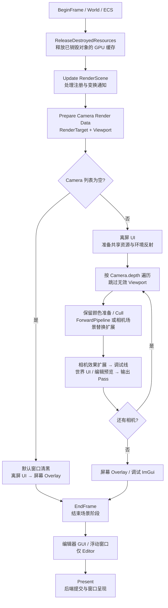
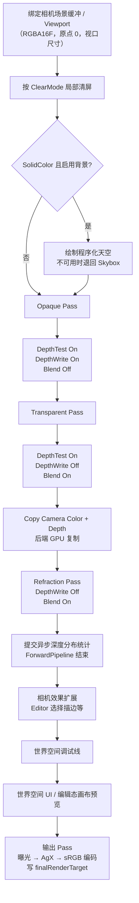

# Orbeden 渲染管线概览

Orbeden 使用单线程 Forward Renderer，通过公共 `RenderBackend` 接口执行 OpenGL 4.3 与 Vulkan 1.3 后端。渲染组件主动注册到持久 `RenderScene`，每帧增量刷新变换和资源版本，再为各相机执行裁剪、SubMesh 展开、排序和绘制。

本文描述当前已实现的渲染流程与后端职责。引擎更新和 SDK 同步要求见 [构建与打包](BuildAndPackaging.md)；坐标与空间约定以 [项目规范](ProjectConventions.md) 为准。

## 核心模块

| 模块 | 职责 |
| --- | --- |
| `RenderSystem` | 初始化、帧调度、多相机、Viewport、RenderTarget、Overlay |
| `TransformCache` | 根据 Transform 通知更新脏子树 |
| `RenderScene` | 持久维护 Camera、DirectionalLight、StaticMeshRenderer 指针注册 |
| `SceneCuller` | Layer Mask 与视锥裁剪 |
| `RenderItemSorter` | 相机可见项的队列与距离排序 |
| `DrawBatchBuilder` | 绘制项收集、兼容性分组、材质排序与几何路径选择 |
| `StaticBatchCache` / `GeometryExpander` | 持久静态批、拓扑缓存与 CPU 几何展开 |
| `ParticleRenderer` | 粒子、拖尾的实例数据与展开几何 |
| `ForwardPipeline` | 阴影、天空盒、环境反射绑定、Forward Main Pass 与原生 Refraction Pass |
| `AtmosphereRenderer` | 太阳透光率、空气透视图集、程序化天空三张查找表与表面加雾参数 |
| `GpuResourceManager` | GPU 资源按需上传、缓存和释放 |
| `RenderBackend` | 资源、参数块、管线状态、Pass、裁剪与多窗口呈现接口 |
| `OpenGLRenderBackend` / `VulkanRenderBackend` | 各 API 的资源、命令与同步实现 |
| `ShaderCompiler` | 共同 GLSL 的 Vulkan 编译、跨阶段链接与布局反射 |
| `ICameraRenderExtension` | 替换指定相机的场景绘制，或在场景输出前追加效果 |
| `UIRenderer` | 离屏画布、世界空间 UI、编辑预览与屏幕 Overlay 的原生绘制 |
| `ImGuiRenderer` | 通过公共接口提交编辑器、调试 Overlay 和浮动窗口 |
| `Profiler` / `ProfilerPanel` | CPU 作用域历史、异步 GPU 检查点与单帧导出 |

## 单帧总流程

全局环境反射在 `ForwardPipeline::PrepareFrame` 选择来源，由 `GpuResourceManager::GetEnvironmentReflection` 返回非拥有型 `GpuEnvironmentReflection`（Cubemap、最大 LOD、线性强度）。Cubemap 的缓存与释放仍归资源管理器，每帧刷新采样数据；切换内容根或清理缓存会清空管线引用。

材质通过统一的 `u_EnvironmentTexture`、`u_EnvironmentMaxLod`、`u_EnvironmentIntensity` 与 `environment_reflection.orbinc` 采样，不直接查询天空盒。纹理槽放在材质纹理、阴影和两张相机纹理之后，避免覆盖已有绑定。没有有效资源或强度为零时返回零贡献。

后续局部探针可在绘制物体前按位置选择采样数据；GGX 预过滤可替换生成 Cubemap 的路径与 LOD 映射。这些接入点尚不包含探针捕获、混合、视差校正或屏幕空间反射，不提前建立空实现。



离屏 UI 先于相机绘制，供后续材质和画布采样；世界空间 UI 与编辑态画布预览写进相机场景缓冲，经过同一个输出 Pass。屏幕 Overlay 在相机输出后合成。Editor 的面板与浮动窗口在场景阶段结束后绘制，最后统一呈现；Player 跳过 Editor GUI 阶段。

相机扩展绑定到完整相机句柄。声明 `replaceSceneRendering` 时替换 `ForwardPipeline`，之后仍执行该相机的效果扩展、调试线、UI 和颜色输出。选择描边和线框属于 Editor 扩展，Core 不维护编辑器选择状态。

### 1. 更新持久场景

`RenderScene` 在绑定 World 时完整收集一次已有组件，后续由 Camera、DirectionalLight 和 StaticMeshRenderer 的 Attach、Detach 与 enabled 变化维护注册：

- `Transform` setter 和父级变化通过 `ITransformListener` 通知各 `TransformCache`，不再每帧扫描所有 Ens。
- `TransformCache` 只递归更新收到通知的子树，并把本次受影响的 Ens 提供给 `RenderScene`。
- Camera 生成 View、Projection、ViewProjection 和视锥快照，并按 `depth` 升序排列。
- DirectionalLight 复制光照与阴影参数。
- `RenderScene` 直接保存 StaticMeshRenderer 指针，变换、Mesh revision 和世界 AABB 缓存在组件自身的运行时状态中。
- 全局场景不保存扁平 SubMesh 列表；只有相机剔除后的 Renderer 才临时展开 `RenderItem`。

渲染读取期间发生的组件增删会以组件指针排队到安全阶段执行，避免遍历过程中修改指针列表。

### 2. Viewport 与 RenderTarget

Camera 使用归一化 Viewport，默认 `(0, 0, 1, 1)`。RenderSystem 根据窗口或离屏目标尺寸换算为像素区域，并重新计算相机宽高比和视锥。

- `renderTargetId = 0`：最终输出到窗口。
- 有效非零 ID：最终输出到离屏目标。
- 无效 ID 或零尺寸 Viewport：跳过该相机。

**`renderTargetId` 描述的是最终输出目标，不是几何的绘制目标。** 每个有效相机都会由 RenderSystem 自动分配一块与 Viewport 同尺寸的 `RGBA16F` 场景缓冲，几何、光照、描边与调试线都画在它上面，再由输出 Pass 转换到最终目标（见 [颜色管线](ColorPipeline.md)）。编辑器视口的离屏目标是显示目标，保持 `RGBA8`。

普通 RenderTarget 由纹理附件和后端目标对象组成：OpenGL 使用 FBO，Vulkan 保存供 Dynamic Rendering 使用的附件组合。创建、Resize、项目 Reload 和 Shutdown 都由 RenderSystem 统一管理。相机保存的是逻辑 `RenderTargetID`，由 RenderSystem 映射到 `GpuRenderTargetID`；后端 ID 不应在业务层当作原生 GL／Vulkan 对象使用。

每个有效相机还会自动持有一组与 Viewport 同尺寸的 GPU 快照：

- `CameraColorTexture`：场景缓冲在透明队列之后的线性 HDR 副本，供折射队列采样。
- `CameraDepthTexture`：在相同时间点复制的 D32F 深度；普通透明物体默认不写深度。
- 相机场景深度与深度快照在两个后端均使用 D32F。快照始终生成，不需要相机开关，材质直接在 GPU 上采样。

UI 命中检测另有单像素深度读取路径：`UIRenderer` 校验视图、观察者和已呈现帧号，再从该视图公布时记录的目标调用 `ReadDepthPixel`。这是同步读回；Vulkan 会提交相关命令并等待结果，不能把它当作无等待的 GPU 快照采样。

### 3. 每相机裁剪与排序

可见性筛选、RenderItem 展开与初始队列排序发生在 RenderSystem 的 Render/Cull 范围；主 Pass 的按材质重排和合批由 ForwardPipeline 的 BuildFrameBatches 执行。

裁剪规则：

1. `renderer.drawLayer & camera.drawLayerMask` 必须非零。
2. Renderer 运行时缓存的 `worldBounds` 必须与相机视锥相交。
3. `VisibleItem` 只保存 `renderer + cameraDistance`。
4. 剔除完成后，按可见 Renderer 当前的 Mesh/SubMesh 生成相机临时 `RenderItem`。

排序规则：

- Opaque：初始近到远排序；`DrawBatchBuilder` 随后在连续可重排区间内按 Shader 基础程序、Material 聚集网格组，同材质的组按最近距离排列，组内仍近到远。
- Transparent：远到近。
- Refraction：远到近。

不透明重排仅用于单 Pass Standard、深度测试开、深度写开且混合关的项。`Individual`、多 Pass、特殊深度／混合状态项构成排序屏障，不跨区间聚合。相同 Material 的不同网格在可重排区间内保持相邻；Shader 基础程序用于分组，最终绘制仍选择各自的 Uniform／Instanced／Expanded 变体。材质排序的提交行为见下文「材质排序与 Uniform 提交」。

队列是离散语义标记，不提供自定义数值优先级。已有序列化数值保持 `Opaque=0`、`Transparent=1`，原生折射使用 `Refraction=2`。

### 4. 每相机级联阴影

ForwardPipeline 选择第一个开启阴影的方向光，由 CascadedShadowMap 在当前相机主 pass 前绘制 1..6 级稳定 CSM。两列 D32F atlas 按顺序相机复用；各相机的 SDSM 历史按 EnsId 独立保存。

- 包围球稳定投影、世界纹素网格对齐、级联过渡、4×4 tent PCF 和接收面深度修正。
- 投射物从完整场景收集，遵守 layer mask、castShadows 与 Opaque 队列，包含相机外上游遮挡物。
- shadowBias 使用世界单位，shadowNormalBias 使用本级纹素倍数。实际接收范围不超过相机 farPlane。
- shadowAdaptive=false 使用固定 CSM 分区；true 使用冻结相机深度的 64 桶对数直方图调整内部边界。
- 后端 compute 在主绘制后提交，完成状态零超时轮询；没有有效统计时仍保持完整 CSM 覆盖，不等待 GPU。
- 任意材质 alpha discard、顶点位移没有自动的 ShadowCaster Pass，当前只保证不透明几何轮廓一致性。

配置、算法、Shader ABI、验证清单见 [SDSM / CSM 详细方案](CascadedShadows.md)。

### 5. Forward Main Pass



相机主 Pass 的目标是引擎分配的场景缓冲，所以它的原点恒为 `0`；`viewportX/Y` 只在输出 Pass 写到最终目标时才有意义。

输出 Pass 必须排在描边与调试线之后：那些内容也写进场景缓冲，要一起转换到显示空间。它是全引擎唯一的显示编码点，细节见 [颜色管线](ColorPipeline.md)。

绘制队列由 `Shader.drawQueue` 提供默认值（缺省为 `Opaque`）。`Material.overrideDrawQueue` 默认关闭；开启后采用 `Material.drawQueue`，`Material.GetDrawQueue()` 返回最终队列。未绑定 Shader 且未覆盖时返回 `Opaque`（材质能否实际绘制仍由资源有效性决定）。Renderer 不再保存队列，同一 Renderer 的不同子网格可以分别使用不透明、透明或折射材质；阴影仅绘制最终队列为 `Opaque` 的子网格，并受 Renderer 的 `castShadows` 控制。

OrbShader 在所有 Pass/阶段之前声明一次全局队列，适用于该 Shader 的全部 Pass：

```text
--------queue Transparent

--------vert
...
--------frag
...
```

队列支持 `Opaque`、`Transparent`、`Refraction`，不区分大小写；省略声明时使用 `Opaque`，重复声明、未知值或在 Pass/阶段之后声明会导入失败。材质内部格式 `.orbmat` 可用 `drawqueue Transparent` 指定材质覆盖，`drawqueue Auto` 或省略该行表示继承 Shader。运行时也可通过材质的两个字段设置；关闭覆盖后立即恢复当前 Shader 默认值，切换 Shader 不会清除已有材质覆盖。

每个 `RenderItem` 会按 Shader 中的 Pass 声明顺序连续绘制。Pass 可独立配置 `DepthTest`、`DepthWrite`、`Blend` 和 `Cull`；`Auto` 每次从当前 Opaque、Transparent 或 Refraction 队列基线解析，不继承前一个 Pass 的状态。

`ClearMode` 含义：

- `SolidColor`：清颜色和深度，并允许绘制天空盒。
- `DepthOnly`：只清深度，保留最终目标已有的颜色。
- `None`：完全保留最终目标内容。

场景缓冲是每相机独立的；`DepthOnly` 与 `None` 每次渲染前都通过 `CopyRenderTarget` 把最终目标的当前颜色复制进场景缓冲，深度不从显示目标导入。清屏限制在当前 Viewport，因此分屏相机不会互相清除画面。

绘制时，`configuredPrograms` 对每个相机、每个绘制队列中的每个 Shader Program 只准备一次相机／灯光等公共参数。Material 参数在材质、GPU 绑定版本或 Pass Program 变化时设置，先写入公共 `ShaderParameters`；后端在 Draw 时提交变化值或上传参数快照。各几何变体是独立 Program，分别保存参数状态。

Refraction Pass 是引擎原生阶段。进入该阶段前，管线一次性冻结相机颜色和深度，并自动绑定：

```text
u_CameraColorTexture
u_CameraDepthTexture
u_UseCameraTextures
u_CameraNearPlane
u_CameraFarPlane
u_Time
```

新项目包含 `Builtin/camera_texture_common.orbinc`、雨水玻璃和热浪 Shader 范例。这些 Shader 已声明默认 `Refraction` 队列，材质默认继承，无需在 Renderer 上配置。

### 6. 物理大气与空气透视

`AtmosphereRenderer` 用球形大气做单次散射，产出三张查找表，供背景与表面共用：

| 查找表 | 内容 | 尺寸（Low / Balanced） |
| --- | --- | --- |
| 太阳透光率 | 二维，节点按高度平方与视线余弦平方分布 | 128×64 / 256×64 |
| 空气透视图集 | 每相机一套，距离层 × 视口节点，L 与 Tau 各一张 | 96×56 / 288×112 |
| 天空查找表 | **方向空间**（与相机朝向无关），只含沿射线的大气散射，不含太阳盘与地球底板 | 96×48 / 192×96 |

- 透视与天空模式由 `RenderSettings.skyMode` 独立选择，默认 `Cubemap`；`atmosphere.fogEnabled` 只控制物体表面的空气透视。四种组合互不隐含：Cubemap＋FogOff 完整保留原有画面，Cubemap＋FogOn 只给表面加雾，Atmosphere＋FogOff 只换背景，Atmosphere＋FogOn 天空与表面共用同一份密度、太阳输入与散射算法。
- 查找表在主 Pass 之前生成，一张全屏四边形一个 Pass，不嵌套主 Pass；材质只查询图集，不做光线步进。
- 天空表按**方向**而不是屏幕坐标存放：行是地平线相对仰角（地平线落在 v=0.5 的节点行边界上、靠地平线平方加密），列是视线与太阳方向的夹角余弦。这样从外空间看，大气顶边缘 6~12 px 宽的辉光带能落在密集行里，而不是整条挤进同一行被放大成屏幕轴对齐的台阶；表也因此与相机朝向无关。
- 查找表里不放二值判定。地球遮挡由天空着色器逐像素解析求交，覆盖率按 fwidth 估计的边界宽度做一像素过渡（和太阳盘同一套）；地平线两侧的查找表采样分开取（各自夹到 0.5∓半行），按覆盖率混合，避免表跨地平线把"掠射天空"和"近地散射"混成一个不代表任何一侧的值。地面底板的透光率：相机在大气外时沿视线查一次透射率表；在大气内时地面到相机是一段近距离，直接在射线上按 4 步积分（透射率表给不出这一段——近地平线方向两端的 τ 都很大，而需要的是它们之间不到 1 的差，半精度表表示不出来）。逐通道且随像素变化。透射率表存的是光学厚度 τ 本身，不是 exp(−τ)：掠射时 τ 能到 20 上下，存 exp(−τ) 会在半精度里让蓝通道下溢成 0。
- 表面合成在光照、自发光与 tint 之后：alpha 混合用 `rgb × T + L`，加性混合只用 `rgb × T`。折射与热浪采样的相机颜色已经含雾，不再调用表面加雾函数；雨玻璃只给本地反光乘该表面的 `T`。
- 菜单与设置入口在 Rendering 面板；世界文件保存全部大气参数，缺失属性按默认值读取。

相机高度没有停用阈值：每条射线由着色器求大气球壳的入射点、出射点与地球交点，相机在大气层外时从入射点开始积分，射线不经过大气时返回零散射与单位透光率，观察表面时再以表面距离截断。只有落到地心以下的位置才判为无效并回退天空盒。

**浓雾**是独立于球形大气的第二种介质，默认关闭，有自己的开关（`denseFog.enabled`），不受 `fogEnabled` 支配。密度模型由 `denseFog.mode` 选择：`Height` 密度只随高度变化（谷地积雾、山脊露出），`Distance` 密度与高度无关、只按相机距离加雾（没有高度参数，适合由脚本按飞行高度驱动）。它用 `visibilityMeters` 按 MOR（5% 透射阈值）描述自身消光，雾层没有底面：低于雾顶高度的所有高度都保持满密度，只在雾顶一侧衰减。高度按**平地近似**沿射线线性变化，分段剖面因此整条有初等原函数，透光率是路径积分的一次求值——不建查找表，也不做逐像素求积与球面边界求交。散射亮度取世界环境光乘 `fogScatteringScale`，环境光为零时浓雾不发光，夜间不会自行泛白。六面天空与程序化天空都被浓雾遮蔽，各算一次。

两种介质各自独立开关，合成顺序固定为**先空气透视、后浓雾**：透光率相乘，薄霾的散射亮度再乘浓雾透光率，浓雾散射按 `散射色 × (1 − 透光率)` 计入。浓雾是近场介质，叠在最外层；相机在雾层内时这与逐段积分一致，相机在层外俯视时是有偏差的顺序合成。程序化天空仍由 `skyMode` 独立控制。

限制：透视距离上限 2500 km；不实现多次散射、臭氧、月亮、星空、云层与地形体积阴影；浓雾不做水平雾区、三维噪声、降落灯光束与体积阴影；程序化天空不自动烘焙反射 Cubemap，反射环境始终独立配置；夜景单次散射偏暗，环境照明与反射不由此功能补偿。算法、参数与验收见 [大气散射设计](AtmosphereScatteringDesign.md)。

### 7. OrbShader 多 Pass

旧的单组 `vert/frag` 文件会自动成为名为 `Default` 的 Pass。多 Pass 文件使用以下格式：

```glsl
--------pass Outline
depthTest auto
depthWrite off
blend auto
cull front
--------vert
// vertex GLSL
--------frag
// fragment GLSL
```

Pass 名称区分大小写且必须唯一；分段和状态关键字不区分大小写。每个 Pass 必须各有一个 `vert` 和 `frag`，状态只能写在 Pass 头与第一个 Shader Stage 之间。支持的值为：

- `depthTest`、`depthWrite`、`blend`：`auto`、`on`、`off`。
- `cull`：`auto`、`none`、`front`、`back`。

内置表面 Shader `blinn_phong`、`pbs_metallic`、`transparent`、`refraction` 在 `Default` Pass 中显式使用 `Cull Back`，Uniform／Instanced／Expanded 变体沿用同一 Pass 状态。正面为 引擎约定的 CCW 绕序，背面不进入光栅着色；该设置不会省去已提交顶点的变换工作。负缩放改变绕序时沿用现有处理，不自动翻转正面定义。

天空盒、大气、UI、粒子、雨玻璃、热尾流以及阴影 Pass 保持原剔除状态。自定义 Shader 省略 Cull 或使用 `Cull Auto` 时仍按 None 处理；需要双面显示的表面可使用显式声明 `Cull None` 的自定义 Shader。现有项目需同步 Builtin 模板并重新导入上述四个 Shader，材质引用与模型资源无需修改。

## GPU 资源缓存

Mesh、Texture、Skybox、Shader、Material 在第一次使用时上传到 GPU。Shader 的所有 Pass 会作为一个整体编译和缓存，任一 Pass 编译失败都会使整个 Shader 无效。

缓存有效时直接返回；无缓存或版本变化时创建/刷新 GPU 对象。每帧开头的 `ReleaseDestroyedResources` 释放已销毁 CPU 对象对应的 GPU 对象和缓存项。

后端还会过滤重复绑定和状态设置。OpenGL 缓存 Program、每上下文 VAO、Texture Slot、Depth／Blend 状态与 Uniform Location；Vulkan 缓存资源引用、图形管线、Descriptor Set 与命令绑定状态。资源缓存负责对象是否有效，提交缓存负责本次 Draw 是否需要重新绑定，两者分别维护。

## 材质排序与 Uniform 提交

公共层按 Program 保存 `ShaderParameters`，按绘制提交 `PipelineState`。Shader／Material 排序继续聚集兼容绘制；每个相机、队列与 Program 分别准备公共参数，连续相同材质且 GPU 绑定版本未变时复用材质参数与纹理绑定。对象矩阵、实例 tint／UV、接收阴影及加性混合标记仍随批次更新。调用方写入的是 CPU 数据，不执行原生图形 API。

参数写入先比较 CPU 值，只把变化项加入待提交列表；重复写入同一项只排队一次。后端消费列表后清空标记，不逐绘制遍历全部参数。数组名和首元素名（如 `u_Colors` 与 `u_Colors[0]`）指向同一个缓存项。

| 后端 | 参数与状态提交 |
| --- | --- |
| OpenGL | 只消费变化列表，再按实际 uniform 位置和值过滤；缓存深度、混合、剔除、线框及深度偏移状态；顶点输入的原生 VAO 按窗口上下文分别创建 |
| Vulkan | glslang 把独立参数归入 set 0 / binding 0 的动态 Uniform Buffer；反射偏移与 CPU 参数项只关联一次，变化项增量更新 std140 布局。参数变化后上传帧内不可变快照，以动态偏移选择当前绘制数据；同一帧的相同缓冲页、采样器、图像和存储缓冲组合复用 Descriptor Set。采样器绑定从 1 起自动分配 |
| 固定功能状态 | 深度、混合、剔除、线框、图元类型与深度偏移共用 `PipelineState`；Vulkan 按 Shader、输入布局、附件格式和状态缓存管线 |

## 几何合批与拓扑缓存

- 主画面的绘制路径按渲染器的 `drawStrategy` 与批次可合并性选择：`Auto` 依次尝试持久静态批、实例批、动态展开批，都不成立才逐对象绘制；`Individual` 始终单绘制并作为排序屏障；`GpuInstancing` 与 `DynamicBatching` 各自限定一种合批方式，条件不足时退回单绘制。实例批要求同 Mesh、子网格区间与材质；动态展开批只要求同材质与同渲染状态，用 `DrawIndexedInstanced` 与 `DrawIndexed` 分别提交（持久静态批直接绑定缓存组的顶点输入）。Indirect Draw 尚未实现。
- 阴影中的 `Auto` 普通网格先复用有效持久静态批；其余项只尝试 GPU 实例批，条件不足时直接绘制原 GPU 网格，不逐级联进行 CPU 动态几何展开。显式 `DynamicBatching`、粒子与显式实例提交保持原路径；不修改 Renderer 保存的策略。`Render/Shadows` 记录阴影入口，`Cascade`、`BuildItems`、`BuildBatches`、`DrawBatches` 记录各级联；其中 `DrawBatches` 包含 Pass 建立、状态设置、绘制提交与结束，不是 GPU 时间查询。
- 每次相机渲染只收集一次普通网格和显式实例的阴影候选，再按级联视锥筛选；同一 Renderer 的子网格共享一次包围盒判断。持久静态批和粒子保留逐级裁剪路径，投射物分区包围盒继续使用原筛选规则并复用存储容量。`Render/Shadows/CollectItems` 记录共享收集阶段，`BuildItems` 记录级联筛选和静态批／粒子追加；不跨相机或跨帧复用候选内容。
- `StaticMeshRenderer` 只是组件类名，**不代表它所属的 Ens 已 static**：是否进入持久静态批由 Ens 的 `static` 约束和渲染器的 `drawStrategy` 共同决定。

展开几何的引用计数与局部索引按 Mesh 内容版本缓存，首次构建同时完成索引校验和首次引用顺序映射；网格修改后重建，销毁后清理，资源失效时清空。每批仍重新计算世界空间顶点；位置、法线、切线公式和 32 位索引格式不变。索引输出直接复制缓存映射并加顶点基址，已消费的展开块回收容量供后续批次复用。`GetTopology`／`BuildTopology`／`ReserveBuffers` 记录拓扑与容量准备；`ValidateIndices` 包含拓扑缓存读取或重建，首次录制需区分冷缓存和后续帧。

CPU 展开按绘制项准备共享变换系数，`PrepareTransform` 记录准备耗时；`TransformVertices` 记录顶点计算与写入。x64／启用 SSE2 的 x86 使用 SSE2 并行计算位置、法线、切线与 UV 分量，其他目标使用标量路径；不要求 AVX，不修改公共向量布局或 GPU 顶点格式。合批判定优先保留后续可实例化的连续组，实例能力不足时继续尝试策略允许的动态批。

普通 Renderer 的 CPU 动态批预算如下，按子网格绘制项计算：

| 条件 | 当前值 |
| --- | --- |
| 单项最多有效引用顶点 | 128 |
| 单项最多索引 | 384 |
| 连续兼容项最低数量 | 8 |
| 整批最多有效引用顶点 | 1024 |
| 整批最多索引 | 3072 |

先拒绝索引超限项，再读取引用顶点统计；不足门槛或超限时复用原 GPU 网格绘制。Auto 与显式 DynamicBatching 共用门槛，GPU Instancing、持久静态缓存和粒子／显式实例路径不受这组普通网格预算约束。预算的实际收益需在目标场景测量。

## Vulkan 命令、资源与缓存

### 帧资源与提交

Vulkan 在主线程录制命令，使用三组循环帧资源。每组持有命令池、命令缓冲、fence、上传页、Descriptor Pool、时间戳 Query Pool 和延迟释放队列；计算与图形使用同一条队列。

| 入口 | 当前行为 |
| --- | --- |
| `BeginFrame` | 已在录制时直接返回；开始新帧时回收已完成 GPU 计时，等待即将复用的帧 fence，释放该帧退休对象，重置上传区间、Descriptor Pool 和命令池，再开始录制 |
| `BeginPass` / `EndPass` | 建立／结束 Dynamic Rendering 范围；同一帧可包含多个相机、离屏目标和窗口，Pass 结束不等于队列提交 |
| `EndFrame` | 结束场景阶段的 Pass；Editor 随后继续在同一后端帧录制面板与浮动窗口 |
| `Present` | 将已获取窗口的图像转为呈现布局，提交当前命令缓冲并关联帧 fence，再呈现这些交换链；信号量按交换链图像保存 |
| `WaitForIdle` / 内部 `Flush` | 为必要的同步读回、资源回收或交换链重建提交已录制命令并等待；有新命令时结束当前片段，完成后另开命令缓冲继续录制 |

静态顶点／索引缓冲分配在设备本地内存，通过上传区间和拷贝命令初始化。帧内上传页从 8 MiB 起分配，使用可映射、Host Coherent 内存并按用途对齐；Uniform 快照通过动态偏移选择本次 Draw 的数据。

流式缓冲保留最新 CPU 内容，跨帧首次使用时按需复制到当前帧上传区间；同帧后续上传分配新范围，不覆盖旧 Draw 已引用的数据。缓冲对象原地更新，Draw 每次从对象读取最新句柄、偏移和已用范围。仍可能被 GPU 使用的原生资源进入帧退休队列，完成后释放。

图像依赖使用 Synchronization2 跟踪布局、阶段与访问标记；转为附件、采样、传输或计算用途时建立相应依赖，需要时暂停并恢复渲染范围。复制相机快照、UI 中间目标和深度统计都走后端接口，不依赖 OpenGL 的隐式状态转换。

### 缓存与失效

| 缓存 | 复用范围与失效条件 |
| --- | --- |
| 程序与活动绑定 | 绑定切换时查找程序，连续 Draw 使用活动引用；删除当前程序时清空绑定 |
| 顶点输入 | 创建时保存顶点／索引缓冲引用和实例步长；删除缓冲时扫描输入并清除关联引用，删除当前输入时清空活动绑定；重复绑定同一输入仍重置实例绑定 |
| Pass 附件 | 缓存颜色／深度附件供参数准备、渲染恢复与管线查找复用；结束 Pass、改挂深度、删除附件／表面或重建交换链时清空 |
| 帧缓冲固定参数 | 高度与窗口标记按值递增版本；每个程序只在版本变化或参数被外部写入后重新设置 `u_OrbedenFramebufferInfo` |
| 图形管线 | 按程序、输入布局／步长、附件格式和固定功能状态缓存；连续相同状态直接复用最近管线，程序删除后随退休资源释放派生管线 |
| Descriptor Set | 同一帧按参数缓冲页、采样器、图像与存储缓冲组合复用；资源绑定、采样槽参数、图像访问或缓冲页变化时重新检查依赖，新帧重新建立帧内缓存 |
| 原生命令绑定 | 仅更新变化的管线、Descriptor Set／动态偏移、顶点／索引缓冲和深度偏移；开始新命令缓冲时清空命令绑定缓存 |

这些缓存减少 CPU 准备工作，保留原有绘制项、Shader 布局与图像依赖。当前引擎仍逐批次在主线程提交，Vulkan 不会仅凭 API 名称自动获得更高帧率；后续优化应按 CPU 提交、几何处理或 GPU 执行的实测瓶颈选择。

## 后端选择与坐标契约

Editor 在 **Editor Settings → Rendering Backend** 选择 OpenGL 或 Vulkan，按 Apply 在当前会话切换，不需要启动参数或重启。选择写入项目文件的 `<EditorGuiConfig graphicsBackend="OpenGL|Vulkan">`，项目打开后自动应用；旧项目默认 OpenGL。Play 期间禁用切换。

切换在帧边界执行：创建替换窗口、保存面板布局，等待旧后端并释放 GUI、浮动窗口和编辑器视口；RenderSystem 验证新后端与离屏目标后再替换旧渲染系统。新后端验证失败时保留旧后端并重建 GUI；切换后的 GUI 初始化失败时尝试恢复原窗口和后端。World、未保存编辑、选中状态与布局保留，GPU 缓存按新设备重建；RenderSystem 保留的离屏目标沿用逻辑 ID，编辑器视口由编辑器重新创建。

Player 通过 `--graphics-api vulkan` 或 `--graphics-api opengl` 选择，默认 OpenGL。Vulkan 要求 1.3、Dynamic Rendering、Synchronization2，以及当前编辑器线框所需的非实心填充能力；初始化不支持时报告失败。

世界空间、CPU 投影、视锥、阴影矩阵及 Shader 传递的逻辑裁剪坐标继续使用右手系与 `[-1,1]` 深度。Vulkan 编译入口在最终位置上做 `z = (z + w) / 2`，显示窗口使用负高度 viewport；离屏纹理保留原来的 UV 约定。默认片元坐标与 Y 导数由生成的共享入口统一适配。现有深度还原、折射 UV 和阴影采样公式继续使用逻辑约定。

颜色与深度格式按用途区分：

| 用途 | OpenGL | Vulkan |
| --- | --- | --- |
| 相机场景颜色／相机颜色快照 | RGBA16F | RGBA16F |
| 相机场景深度／相机深度快照 | D32F | D32F |
| 级联阴影 atlas | D32F | D32F |
| 一般深度纹理／显式 RenderTarget 默认深度 | `GpuDepthTextureDesc` 默认 Depth24，`floatingPoint=true` 为 D32F | D32F |

编辑器显示目标默认使用 RGBA8；Vulkan 窗口要求 UNORM SDR 交换链格式。显示编码只在输出 Pass 执行，场景、材质和后端不重复编码。

ImGui 的 `ImTextureID` 保存引擎纹理 ID，由 `ImGuiRenderer` 经公共接口采样。图标上传、线框、调试线和浮动窗口不再直接调用 GL；附加窗口通过 Surface 共享设备资源。

## Profiler 采集与性能分析

Profiler 保留普通 CPU 作用域、层级、时间线和异步 GPU 视图。`Record` 开始按帧采集，`Stop` 保留历史，`Clear` 清空历史；`Follow` 跟随新帧，关闭后可在走势图选择具体帧。`GPU` 按钮切换到 GPU 区间表，`CPU` 返回 CPU 视图，`Export Frame` 将选中帧导出到桌面。

当前采集不插入阶段或场景结束的强制 GPU 等待，OpenGL 呈现前也不因采集调用 `glFinish`。必要的帧资源复用、交换链获取和同步读回仍可能阻塞 CPU；普通采集不表示渲染流程完全没有等待。Vulkan 专用 CPU 细分表及两个临时诊断勾选已清理。

### CPU 作用域

CPU 数据是作用域墙钟时间，包括函数内部实际发生的 CPU 阻塞。节点的 Total 包含子节点，Self 扣除已记录的直接子节点；不要把父子 Total 重复相加。

| 作用域 | 含义 |
| --- | --- |
| `Render/SceneSync` / `Render/Cull` | 场景增量更新、可见性筛选和初始队列排序 |
| `Render/Shadows/*` | 阴影候选收集、级联构建、合批与绘制提交；DrawBatches 包含 Pass 建立、状态、提交和结束 |
| `Render/BuildBatches` | 绘制项收集、细分排序与批次生成 |
| `Render/DrawBatches/Uniform`、`Instanced`、`Expanded`、`TrailInstanced` | 各几何路径的 CPU 准备和绘制提交 |
| `Render/CopyCameraTextures` | 后端颜色／深度复制调用的 CPU 耗时 |
| `Render/EditorGui/SubmitDraw` | Editor GUI 网格准备、上传与绘制调用的 CPU 耗时 |
| `Render/Present` | CPU 在队列提交与呈现调用中的耗时，不是 GPU 绘制时长或屏幕显示延迟 |

普通批次采样继续细分距离排序、按键分组、组构造与材质重排。展开路径细分拓扑读取／重建、索引校验、变换、索引重排、块提交、状态绑定和 Draw；`Render/ExpandParticles` 也包含普通网格动态展开。采样以批次或网格阶段为单位，不逐顶点记录。每帧最多 4096 条 CPU 事件，保留 1024 帧，原生事件数组约 160 MiB；丢样时 Self 和细分层级不再代表完整记录。

### GPU 区间与异步回填

`RenderBackend::ProfileGpuStage` 在录制时通知后端记录检查点。Vulkan 使用时间戳 Query；OpenGL 当前没有 GPU 时间戳实现，GPU 视图显示 Unavailable。

Vulkan 每帧最多记录 256 个时间戳，即最多 255 个相邻检查点区间。结果在已有帧 fence 完成后读取，不使用 Query WAIT 标记或为取数新增队列等待；按采集代次与原始帧号回填，清空历史后的旧结果丢弃。未完成时显示 Pending；开启 Follow 的 GPU 视图优先选择最近已有结果的帧。

GPU 区间从首个 GPU 时间戳起算，与 CPU 时间线使用不同的时钟，不能按起始偏移直接对齐。区间是前一个检查点至当前检查点的经过时间，可能含 GPU 空闲、调度或命令提交间隔，不等于某支 Shader 的忙碌时间。BeforeScene 对应场景前已录制的工作，例如编辑器主窗口清屏；EditorGuiAndFinalize 覆盖场景检查点之后的编辑器绘制与提交前收尾，Player 中同名区间只表示实际录制的帧尾工作。呈现／显示延迟不在这段 GPU 区间内。

单帧导出使用 `Orbeden.Profiler.Frame.v2`，`CaptureMode` 固定为 `Normal`：CPU 数据保存在 Frame、Categories、Nodes、Events，GPU 数据单独放在 GpuTiming。GPU 记录包含 Ready／Pending／Unavailable 状态、导出数量、丢失数量和完整性标记。Pending 或 Unavailable 的零总量不表示 GPU 用时为零；达到时间戳容量时保留帧尾检查点，丢失位置附近的区间可能覆盖多个阶段。

### 对比方法

1. 固定场景、相机、像素尺寸、阴影设置、VSync／限帧、构建配置与编辑器面板布局；最后用 Release 复核正式性能。
2. 等待资源、Shader、管线和几何缓存预热，再清空历史录制，分开看冷启动尖峰与稳态帧。
3. 同时比较整帧、上层渲染作用域与多帧分布，例如中位数和 P95；不要仅凭 Draw Call 数、单个 Self 或一张快照判断收益。
4. 先区分 CPU 提交与 GPU 执行成本。OpenGL 的 GPU 状态为 Unavailable，不能将它的零总量与 Vulkan GPU 时间直接比较。
5. 采集本身也有 CPU 记录和 GPU 时间戳开销；正常帧率应在停止录制后另行观察。Vulkan 缓存优化应同时看上层 Shadows/DrawBatches、普通绘制和整帧，避免把工作从 Draw 移到绑定入口误判为全部消除。

## 当前边界

- 提供 OpenGL 4.3 与 Vulkan 1.3；当前窗口平台为 GLFW。
- 实际只使用一个主方向光；各相机顺序重绘并复用级联 atlas。
- CSM 每级默认 2048²、4 级，可选择固定分区或异步 SDSM；VSM、云阴影和屏幕空间接触阴影尚未实现。
- 相机裁剪仍为线性扫描，没有 BVH 或 GPU Culling。
- RenderScene 在同一线程增量更新并立即消费。Vulkan 当前没有并行命令录制、独立异步计算队列或 Indirect Draw。
- 所有 Refraction 物体共享同一份冻结快照，因此不会互相折射。
- 普通透明物体全部先于 Refraction 绘制；前景透明物体可能被后绘制的折射表面覆盖。

## 主要源码

| 入口 | 文件 |
| --- | --- |
| 总调度、逻辑目标、后端切换 | [RenderSystem.cpp](../OrbedenCore/Src/Rendering/RenderSystem.cpp) |
| 相机扩展契约与覆盖层接口 | [RenderSystem.h](../OrbedenCore/Src/Rendering/RenderSystem.h) |
| 持久场景与组件快照 | [RenderScene.cpp](../OrbedenCore/Src/Rendering/RenderScene.cpp) |
| 每相机阴影、主 Pass 与折射 | [ForwardPipeline.cpp](../OrbedenCore/Src/Rendering/ForwardPipeline.cpp) |
| 级联阴影与深度统计 | [CascadedShadowMap.cpp](../OrbedenCore/Src/Rendering/CascadedShadowMap.cpp) |
| 绘制项与合批策略 | [DrawBatchBuilder.cpp](../OrbedenCore/Src/Rendering/DrawBatchBuilder.cpp) |
| 拓扑缓存与 CPU 几何展开 | [GeometryExpander.cpp](../OrbedenCore/Src/Rendering/GeometryExpander.cpp) |
| GPU 资源缓存与绑定布局 | [GpuResourceManager.cpp](../OrbedenCore/Src/Rendering/GpuResourceManager.cpp) |
| 公共渲染接口 | [RenderBackend.h](../OrbedenCore/Src/Rendering/Backend/RenderBackend.h) |
| OpenGL 与 Vulkan 实现 | [OpenGLRenderBackend.cpp](../OrbedenCore/Src/Rendering/Backend/OpenGLRenderBackend.cpp)、[VulkanRenderBackend.cpp](../OrbedenCore/Src/Rendering/Backend/VulkanRenderBackend.cpp) |
| GLSL / SPIR-V 编译 | [ShaderCompiler.cpp](../OrbedenCore/Src/Rendering/ShaderCompiler.cpp) |
| UI 绘制与深度查询 | [UIRenderer.cpp](../OrbedenCore/Src/Runtime/Gui/UIRenderer.cpp) |
| CPU 历史与 GPU 回填 | [Profiler.cpp](../OrbedenCore/Src/Profiler/Profiler.cpp) |
| Profiler 面板与导出 | [ProfilerPanel.cs](../OrbedenEditor/Managed/Orbeden.Editor/Panels/ProfilerPanel.cs) |
| Editor 窗口、GUI 与后端切换 | [EditorSystem.cpp](../OrbedenEditor/Src/Editor/EditorSystem.cpp) |
| 渲染基础验证工具 | [OrbedenRenderSmoke](../Tools/OrbedenRenderSmoke/README.md) |
